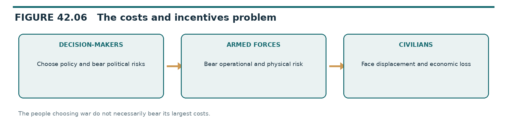

Войната може да бъде катастрофална за населението, но все пак привлекателна за хората, които контролират решението. Един владетел може да очаква военен успех, за да укрепи легитимността им, да потуши конкурентна фракция, да раздаде плячка на съюзниците или да предотврати отстраняването им от длъжност. Висшият командир може да получи повишение от разширяваща се военна институция. Политическите лидери също могат да забавят оттеглянето си от една непечеливша война, защото признаването на поражението може да застраши позицията им. Във всеки случай хората, които избират политики, не понасят разходите по същия начин като войниците и цивилните.

Това не означава, че всяка война е циничен трик от страна на владетелите. Лидерите могат искрено да вярват, че защитават своите общности и демократичните правителства могат да водят агресивни войни. Полезният въпрос е чиито предпочитания са представени в процеса на вземане на решения и как лидерите се държат отговорни. Институциите, които предоставят значима опозиция, независима информация, законодателен контрол и обществен дебат, могат да ограничат някои рискове, но те не премахват дезинформацията, страха или националистическия натиск. Разпределението на политическите разходи има значение заедно с разпределението на военните способности. \[<a href="/042-why-wars-begin/sources/#source-8" class="cite">8</a>\]

<figure class="figure" id="figure-42-6">

<figcaption>Фигура 42.6. Проблемът с разходите и стимулите. Хората, които избират войната, не носят непременно най-големите си разходи. <a class="figure-anchor" href="#figure-42-6" aria-label="Link to this figure">#</a></figcaption>
</figure>
