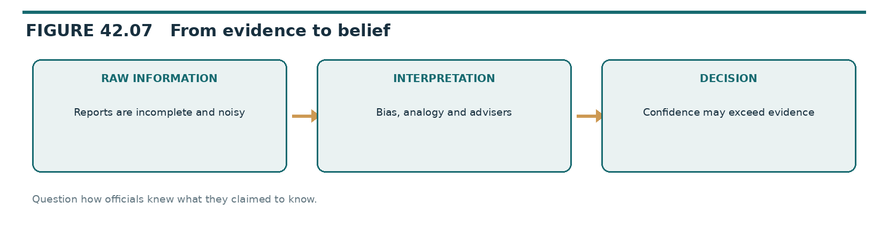

Производителите на решения тълкуват непълна информация чрез умствени преки пътища. Те търсят модели, разчитат на последните спомени и често тълкуват двусмислени доказателства по начини, които потвърждават съществуващите вярвания. Увереността може да расте в малък консултативен кръг, където несъгласието е обезсърчено. Един военен планиращ може да сбърка организационната чистота за оперативна осъществимост; политикът може да предположи, че противникът ще се предаде, защото предишните заплахи са работили. Анализаторите се отнасят до такива модели чрез идеи, включително потвърждение пристрастие, мотивирани разсъждения и групово мислене, въпреки че те не са универсални обяснения за лоши решения. \[<a href="/042-why-wars-begin/sources/#source-11" class="cite">11</a>\]

Историческите аналогии са особено силни. Наричането на съперник "друг Хитлер" или сравняването на спорна намеса във Виетнам може да осветли опасност, но тя също така може да пренебрегне различията в географията, институциите и политическите цели. Аналогията е инструмент, генериращ хипотеза, а не доказателство. Полезна дисциплина е да се запитаме кои факти биха направили сравнението невалидно. По същия начин историците трябва да избягват следите на предразсъдъците: щом знаем резултата, лесно забравяме колко несигурни събития се появяват пред участниците по това време.

<figure class="figure" id="figure-42-7">

<figcaption>Фигура 42.7. От доказателства до вярвания. Въпрос как длъжностните лица са знаели това, което твърдят, че знаят. <a class="figure-anchor" href="#figure-42-7" aria-label="Link to this figure">#</a></figcaption>
</figure>
