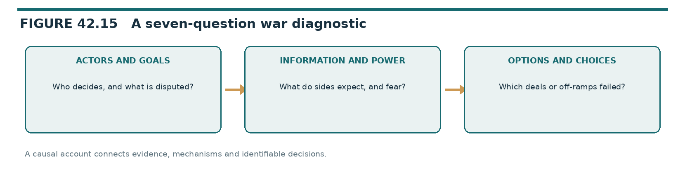

Започнахме с гранична криза, в която лидерите смятаха, че е по-безопасно да се подготвят за битка, отколкото да се доверят на компромис. Сега можем да задаваме по-остри въпроси. Какво точно се оспорваше? Кои партии са имали силата да избират насилието? Какво вярваха всички, че може да спечели и на каква цена? Беше ли опасността незабавна атака, очаквана бъдеща промяна или политическа заплаха у дома? Кои сигнали са подвеждащи? Възможно ли е да се наблюдава или прилага споразумение? Лидерите имаха ли по-добра информация от обществото или по-малко? Кои събития промениха изчисленията между напрежението и стрелбата?

Следователно отговорът на "защо започват войните" не е нито един списък с човешки пороци, нито закон, който предсказва всеки конфликт. Войните могат да възникнат от умишлено разширяване, неуспехи в договарянето, проблеми с обвързването, страх, вътрешни коалиции, идеологически цели, стратегически възможности и погрешно решение в различни комбинации. Можем да изучаваме тези механизми, без да се преструваме, че изтриват човешката агенция или отговорност. Следващите глави ще разгледат географията на властта, военната логистика, дипломацията и закона, които правят тези общи прозрения по-прецизни в частност исторически и съвременни обстоятелства.

<figure class="figure" id="figure-42-15">

<figcaption>Фигура 42.15. Диагностика на седемте въпроси от войната. Причинно-следствената сметка свързва доказателства, механизми и разпознаваеми решения. <a class="figure-anchor" href="#figure-42-15" aria-label="Link to this figure">#</a></figcaption>
</figure>
