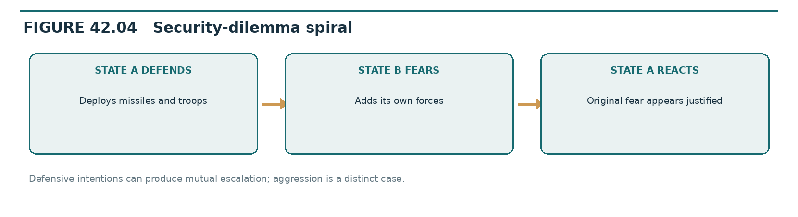

Представете си две държави, които нямат намерение да се нападат. Човек изгражда укрепления и купува ракети, за да стане по-безопасен. Другият вижда ракетите като потенциална офанзивна заплаха и разширява силите си. Първият сега се чувства оправдан в страховете си. Расата може да се развие, въпреки че и двете страни биха предпочели взаимна сдържаност. Това е дилемата на сигурността, разработена в класическата работа на Джон Херц и Робърт Джервис. Важността му се крие в разделението на страха, генериран от несигурността от преднамерената агресия, без да се преструваме, че агресията никога не се случва. \[<a href="/042-why-wars-begin/sources/#source-6" class="cite">6</a>\]

Дилемите на сигурността стават особено тежки, когато оръжията са трудни за класифициране като нападателни или защитни или когато нападателят може да спечели голямо предимство при първия удар. Те могат да се успокоят, когато отбранителните мерки са различими, географията е в полза на поддържането на земя, и държавите могат да проверят позицията си един на друг. Дилемата на сигурността не е синоним на враждебна връзка. Ако едно правителство ясно възнамерява да завоевае, описвайки подготовката на защитника като причина за взаимна несигурност, може да създаде заблуждаваща еквивалентност. Добрият анализ изследва намеренията, способностите и доказателствата поотделно.

<figure class="figure" id="figure-42-4">

<figcaption>Фигура 42.4. Спирала за сигурност и дилема. Отбранителните намерения могат да доведат до взаимна ескалация; агресията е отделен случай. <a class="figure-anchor" href="#figure-42-4" aria-label="Link to this figure">#</a></figcaption>
</figure>
