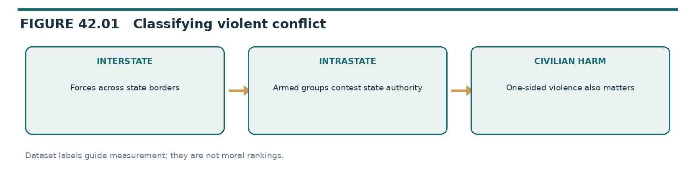

В обикновен разговор, войната може да опише всичко от международна инвазия до граждански конфликт, бунт, кампания на кланета или съперничество, което никога не става насилствено. Изследователите използват по-тесни класификации, така че различни случаи могат да бъдат сравнени. Програмата за данни за конфликтите в Упсала (UCDP) определя държавен въоръжен конфликт, използващ спор за правителство или територия, въоръжена сила между партиите, включително поне едно държавно правителство, и праг от най-малко 25 смъртни случая, свързани с битка, през календарната година. В рамките на този набор от данни "война" означава най-малко 1000 смъртни случая, свързани с битка, за една календарна година. Това са изследователски конвенции, а не морални присъди за това дали насилието в по-малък мащаб има значение. \[<a href="/042-why-wars-begin/sources/#source-1" class="cite">1</a>\]

Преброяването на смъртните случаи от битка също оставя много страдания извън мярката. Болестите, гладът, преместването, изтезанията и насилието, насочени към цивилни лица, изискват различни набори от данни и определения. Междущатска война, гражданска война и кампания на едностранчиви масови убийства могат да се припокриват без да са идентични. Също така трябва да разграничим решението за започване на война от решенията, които го удължават, разширяват или правят насилието изключително разрушително. Рамка, полезна за обяснение на инвазията, може да е недостатъчна за обясняване на бунт или геноцид. Внимателният анализ започва с посочване на резултата, който се опитваме да обясним.

<figure class="figure" id="figure-42-1">

<figcaption>Фигура 42.1. Класифицирайки насилствен конфликт. Ръководство за измерване на етикетите на данните; те не са морални класации. <a class="figure-anchor" href="#figure-42-1" aria-label="Link to this figure">#</a></figcaption>
</figure>
