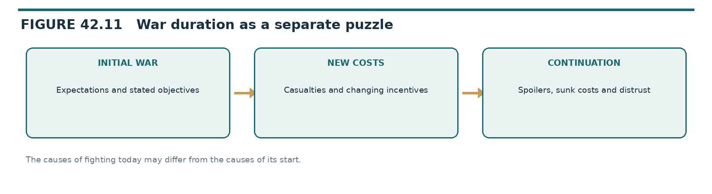

Започването на война и продължаването й са различни решения. В началото всяка страна може да мисли, че победата ще бъде бърза. След месеци бой командирите получават нова информация, но партиите може да не са съгласни със значението на загубите, външната подкрепа или новоизменените политически условия. Водачите могат да залагат на възкресението, надявайки се, че още една офанзива ще обърне иначе неприемливия резултат. Нови въоръжени групи могат да се възползват от контролно-пропускателни пунктове, контрабанда или контрол над помощта. Териториалните промени и зверствата създават допълнителни оплаквания.

Разходите могат да изкривят преценката. Фактът, че хиляди вече са умрели не може сам по себе си да направи по-нататъшните смъртни случаи смисъл; минали разходи са изчезнали, докато бъдещите избори трябва да бъдат оценени от техните вероятни последици. Въпреки това лидерите и поддръжниците могат да видят оттеглянето като предателство, което прави неуспешната война политически по-трудна за прекратяване. Ето защо инициативите за мир следва да разследват дали първоначалните цели остават предмет на преговори, кои участници могат да налагат вето върху уреждането и дали партиите имат достатъчно доверие в следвоенното споразумение, за да спрат борбата. \[<a href="/042-why-wars-begin/sources/#source-19" class="cite">19</a>\]

<figure class="figure" id="figure-42-11">

<figcaption>Фигура 42.11. Продължителността на войната като отделен пъзел. Причините за борбата днес може да се различават от причините за нейното начало. <a class="figure-anchor" href="#figure-42-11" aria-label="Link to this figure">#</a></figcaption>
</figure>
