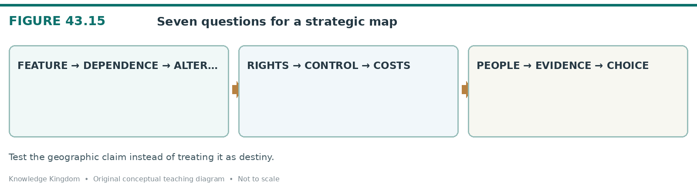

Когато се сблъскате с претенция като "Страна А е предопределена да доминира, защото контролира преминаването към морето," задайте седем въпроса. Каква географска характеристика е включена? От коя икономическа или военна дейност зависи това? Какви алтернативи съществуват и на каква цена? Кой има законни права и оперативен контрол? Кои технологии и институции променят резултата? Кой изпитва ползите и вредите? Какви доказателства показват, че твърдението е фалшиво?

Може да откриете, че функцията създава значително влияние, но само при определени обстоятелства. Може да откриете, че анализаторите са преувеличили значението му, като са пренебрегнали алтернативните маршрути. Може също така да откриете, че местните знания на една малка общност са по - важни от очакванията на далечните служители. Този навик на тестване на пространствени претенции подобрява обществения дебат и помага за разграничаването на сериозна стратегия от географската митология.

Целта на тази глава не е да замени политическата история с топография. То е да пренесем физическото пространство в нашите обяснения за търговия, дипломация, конфликти и развитие, като същевременно запазим мястото на институциите и човешките агенции. Географията предлага ограничения и възможности. Политиката определя как се използват. Следващата глава се превръща във военна организация и логистика: как държавите се опитват да превърнат територията, хората и ресурсите в сили, способни да действат в реалния свят.

<figure class="figure" id="figure-43-15">

<figcaption>Фигура 43.15. Седем въпроса за стратегическа карта. Тествайте географското твърдение, вместо да го третирате като съдба. <a class="figure-anchor" href="#figure-43-15" aria-label="Link to this figure">#</a></figcaption>
</figure>
