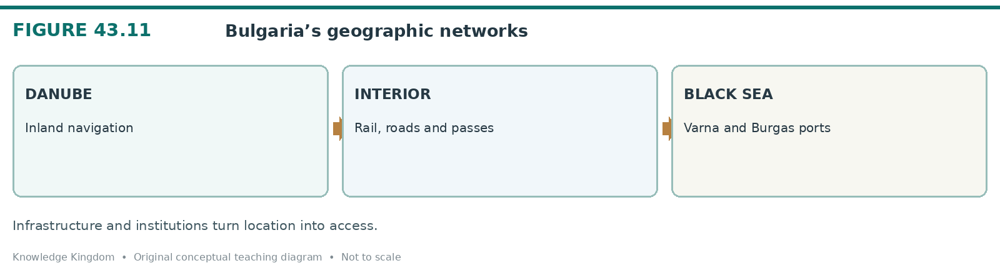

Пътуване с товар през България от Дунав към Егейско-турската граница е оформено от реки, мостове, тунели, планински проходи, качество на пътищата и гранични процедури. Трансевропейските транспортни коридори на Европейския съюз подчертават значението на неоторизираните връзки в Югоизточна Европа. Официалните карти на коридорите определят приоритетите, но планираната инфраструктура не трябва да се бърка с завършен, напълно функциониращ капацитет.

Дунав може да подпомага речния транспорт, но плитките периоди, ограниченията на пристанищата и различните национални разпоредби засягат навигацията. Черноморските пристанища осигуряват морски достъп, докато корабоплаването зависи от преминаването през турския пролив и условията за по-широки търговски маршрути. Пътните и железопътни връзки през София, Пловдив и други градове оформят вътрешната логистика. За селските райони качеството на местен свързващ път може да има по-голямо значение за ежедневието, отколкото линия, която представлява коридор в целия континент.

Стратегическото значение може да даде както икономически възможности, така и задължения. Един силно използван мост изисква поддръжка; логистичният център се нуждае от квалифицирани работници, прозрачни обществени поръчки и ефективни инспекции. Случаят показва защо географията е покана за публичен избор, а не автоматичен източник на геополитическо предимство.

<figure class="figure" id="figure-43-11">

<figcaption>Фигура 43.11. Български географски мрежи. Инфраструктурата и институциите превръщат мястото в достъп. <a class="figure-anchor" href="#figure-43-11" aria-label="Link to this figure">#</a></figcaption>
</figure>
