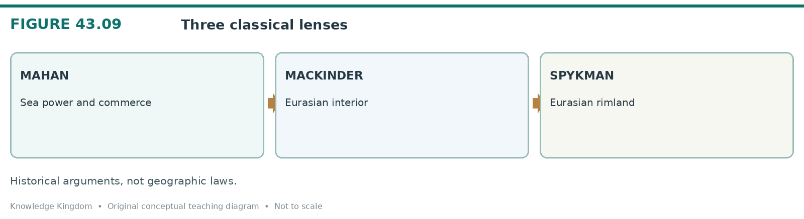

Геополитиката има дълга и сложна интелектуална история. Alfred Thayer Mahan подчерта морската сила; Halford Маккиндър разгледа стратегическите възможности на вътрешността на Евразия; и Николас Spycman даде значение на крайбрежните региони около евразийския интериор. Тези мислители не били съгласни кои пространства имали най - голямо значение. Техните теории отразяват технологиите, съперничеството и политическите опасения на собствените им периоди.

Маккиндър 1904 аргумент за Евразийския "пивот" разглежда как железниците могат да променят баланса между сушата и морската сила. Спайкман по-късно се фокусира върху "римланд," широкия крайбрежен пояс около Евразия. Нито един термин не е естествена граница, която може да бъде начертана с перфектна научна прецизност. Различни автори и карти им дават различно съдържание. Тяхната стойност се състои в това да ни накарат да изследваме мобилността, концентрацията на ресурси и взаимоотношенията между регионите.

Опасността се появява, когато една теория стане пророчество. Твърдение, че който заема един регион "трябва" доминира над земното кълбо, пренебрегва институциите, населението, политическата съпротива, технологиите и променящите се икономики. Няколко геополитически писатели били използвани от имперските или авторитарни движения, за да оправдаят разширяването. Отговорният читател третира класическите геополитически теории като исторически аргументи за оценка, а не команди на правителствата да следват.

<figure class="figure" id="figure-43-9">

<figcaption>Фигура 43.9. Три класически лещи. Исторически аргументи, не географски закони. <a class="figure-anchor" href="#figure-43-9" aria-label="Link to this figure">#</a></figcaption>
</figure>
