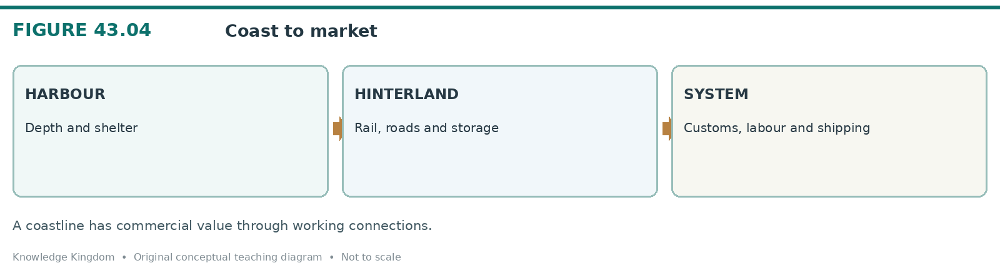

Бреговете осигуряват достъп до риболова, морския транспорт, търговията, туризма и военноморската дейност. Но крайбрежието не е същото като доброто пристанище. Дълбочина, подслон, излагане на бури, близко население, пътни и железопътни връзки, митническа ефективност и наличието на капитал всички оказват влияние върху това дали пристанището става важно. Тесно, трудно или открито крайбрежие може да предложи по-малко възможности от добре свързано речно пристанище във вътрешността.

Морските превози се движат приблизително четири пети от международната търговия на стоки по обем, според ООН търговията и развитието, въпреки че делът по търговска стойност е по-нисък. Това е напомняне, че морският транспорт остава фундаментален дори в епохата на авиационните и цифровите услуги. Наливните стоки и големите контейнери са особено чувствителни към транспортните разходи. В същото време морският достъп изисква морска безопасност, застраховка, инфраструктура и правна способност за преминаване през чужди води.

Крайбрежният град може да свързва далечни пазари, като същевременно води до нови уязвимости: бури, покачване на морското равнище, прекъсване на корабоплаването, концентрация на стратегически активи и зависимост от вносното гориво. Най-добрият географски въпрос не е "Има ли тази страна крайбрежие?," а "Как ефективно и устойчиво свързва хората си с морските мрежи?"

<figure class="figure" id="figure-43-4">

<figcaption>Фигура 43.4. Крайбрежието до пазара. Бреговата линия има търговска стойност чрез работни връзки. <a class="figure-anchor" href="#figure-43-4" aria-label="Link to this figure">#</a></figcaption>
</figure>
