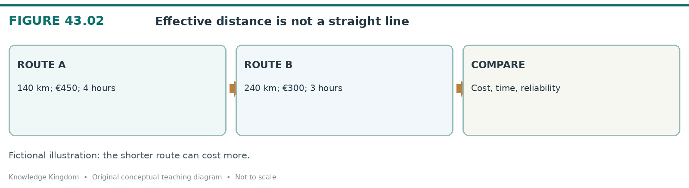

Два града могат да бъдат на 500 километра разстояние и функционира като съседи, ако бърза железопътна линия, отворена граница и евтини товарни услуги ги свързват. Друга двойка само на 150 километра разстояние може да бъде отделена от планини, лоши пътища, несъвместими правила и сезонно затваряне. Следователно разстоянието по права линия е слабо ръководство за ефективна свързаност. Икономистите понякога използват идеята за икономическо разстояние: времето, разходите, несигурността и административните трикове, необходими за преместване на хора, стоки или информация.

За хипотетична илюстрация сравни маршрутите, обслужващи един град. Маршрут А е 140 км и изисква четиричасова планинска разходка с цена 450 евро. Път B е 240 км по надеждна магистрала на 300 евро. Най-краткият път не е най-евтиният. Ако зимните бури затварят маршрут А за десет дни всяка година, разликата в надеждността нараства. Този пример е измислен, за да покаже как да се разсъждава, а не доклад за действителните транспортни цени.

Държавата може да намали ефективното разстояние без да премества планините си. Мостове, ефективни митнически системи, справедливи транзитни споразумения и сигурни цифрови мрежи могат да променят възможностите на региона. Географията определя физическата настройка; инвестициите и сътрудничеството отчасти определят цената за преодоляването му.

<figure class="figure" id="figure-43-2">

<figcaption>Фигура 43.2. Ефективното разстояние не е права линия. Измислена илюстрация: по-краткият маршрут може да струва повече. <a class="figure-anchor" href="#figure-43-2" aria-label="Link to this figure">#</a></figcaption>
</figure>
