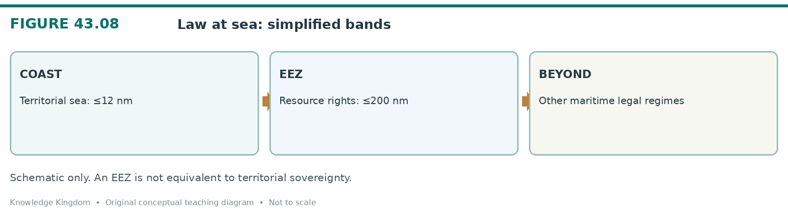

Океанът не е разделен на еднакви суверенни територии. Съгласно Конвенцията на ООН по морско право крайбрежната държава може да претендира за териториално море, простиращо се до 12 морски мили от приложимите базови линии. Договорът предвижда също така изключителни икономически зони, като цяло до 200 морски мили, където крайбрежните държави са определили суверенните права върху ресурсите и някои правомощия на юрисдикцията. Изключителната икономическа зона не е просто териториална земя, простираща се във водата.

Правата на преминаване, навигация и научна дейност зависят от съответната морска зона и правните правила. В проливи, използвани за международна навигация, могат да се прилагат специални режими на преминаване. Договорът съдържа сложни разпоредби за архипелагските води, континенталните рафтове и спорните морски граници; карта с широка сянка около крайбрежието не може да обясни тези правила сами по себе си.

Морската юрисдикция е от значение за риболова, офшорната енергия, опазването на околната среда и стратегическата конкуренция. Но заявената морска зона не гарантира способността да се патрулира. Законът, средствата за прилагане и отношенията с други държави оформят практическия резултат. Дисциплинираният географски анализ разделя законното право от политическото твърдение и действителния контрол.

<figure class="figure" id="figure-43-8">

<figcaption>Фигура 43.8. Закон в морето: опростени групи. Само схема. ИИЗ не е еквивалентна на териториалния суверенитет. <a class="figure-anchor" href="#figure-43-8" aria-label="Link to this figure">#</a></figcaption>
</figure>
