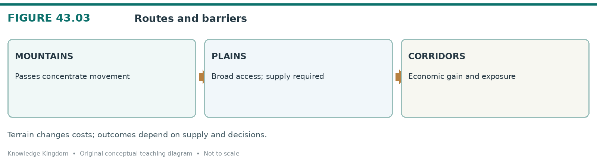

Широките низини често позволяват пътища, железопътни линии, земеделие, селище и бързо движение. За армиите те могат да опростяват логистиката и маневрирането, въпреки че реките, горите, блатата и градовете могат да прекъснат привидно открития терен. В Източна Европа огромните равнини многократно са се включвали в стратегически изчисления; все пак действителните кампании зависят от инфраструктурата, сезона, политическите коалиции, армиите и местната съпротива, а не само от плоскостта.

Коридорът е път, през който движението се концентрира, защото алтернативите са по-бавни, по-скъпи или невъзможни. Някои са физически, като например долина между планините. Други са създадени чрез железопътни линии или погранични договорености. Коридорът може да създаде богатство за градовете по него, като същевременно даде на противника очевиден маршрут за заплаха. Изграждането на повече връзки може да увеличи просперитета и стратегическото излагане в същото време.

Идеята за стратегическа дълбочина в общи линии се отнася до пространството и капацитета, през които една страна може да поеме, забави или устои на атака. Голяма площ може да осигури дълбочина, но не и ако комуникациите рухнат или населението не може да бъде доставено. Малките държави могат да компенсират чрез съюзи, укрепления, мобилност и устойчивост. Дълбочината е връзка между пространството, силите и институциите, а не награда, присъдена автоматично с квадратни километри.

<figure class="figure" id="figure-43-3">

<figcaption>Фигура 43.3. Маршрути и бариери. Теренът променя разходите; резултатите зависят от предлагането и решенията. <a class="figure-anchor" href="#figure-43-3" aria-label="Link to this figure">#</a></figcaption>
</figure>
