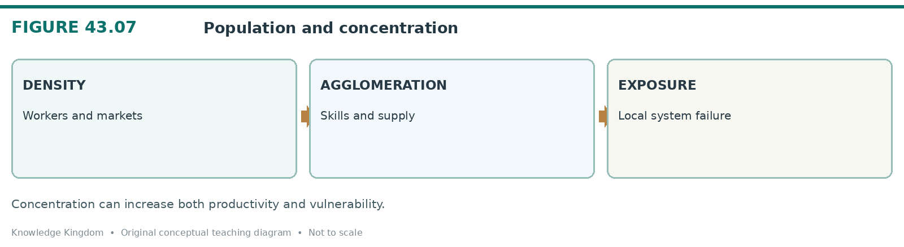

Голямото население може да осигури работници, потребители, войници, изобретатели и данъкоплатци. Тя също така изисква жилищно настаняване, здравеопазване, транспорт, образование и храна. Размерът на населението не се вписва директно в властта; производителността, демографската структура, социалното доверие и институциите оформят това, което едно общество може да направи със своя народ. Стареенето, миграцията и урбанизацията променят модела с времето.

Икономическата дейност често се концентрира в няколко града или коридори, защото фирмите се възползват от близки клиенти, квалифицирана работна ръка и доставчици. Това се нарича агломерация. Концентрацията може да повиши производството, но също така и уязвимостта: наводнението, кибератаката или прекъсването на транспорта в един метрополитен регион могат да повлияят на националното производство. По този начин местоположението на хората е толкова важно, колкото и общата бройка на населението.

Картите на гъстотата на населението могат да се подведат, ако бъдат третирани като доказателство за политическа лоялност. Граничните региони могат да съдържат няколко езика и идентичности, а миграцията променя общностите. Стратегическите дискусии, които намаляват жителите до "човешкия терен," рискуват да пренебрегнат техните права и интереси. Държавите получават трайна сигурност не само чрез окупиране на територия, но и чрез изграждане на институции, които хората смятат за законни и способни.

<figure class="figure" id="figure-43-7">

<figcaption>Фигура 43.7. Население и концентрация. Концентрацията може да увеличи производителността и уязвимостта. <a class="figure-anchor" href="#figure-43-7" aria-label="Link to this figure">#</a></figcaption>
</figure>
