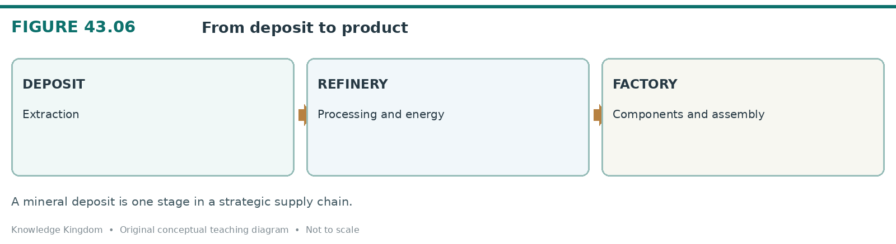

Петролът, газът, металите, плодородната земя, сладководните и горите могат да подкрепят икономическата мощ. Но притежаването на ресурс не е същото като превръщането му в широк просперитет. Извличането изисква технологии, финанси, транспорт, договори, квалифициран труд, управление на околната среда и институции, способни да събират и използват приходи. Ценовите люлки и политическата конкуренция над приходите от ресурси могат да дестабилизират икономиката.

Депозитът може да бъде ценен, тъй като е рядко или трудно да се замени, но ресурсно-енергичен регион може да зависи и от отдалечени клиенти, резервни части или съоръжения за преработка. Стратегическата уязвимост често се намира в цялата верига на доставки, а не в самата мина. Държава, която извлича руда, може все още да внася рафинирани метали, машини или химикали, необходими за собствената си промишленост.

Така нареченото проклятие на ресурсите е спорен модел, а не универсално правило. Някои износители на ресурси развиват способни институции и диверсифицирани икономики; други страдат от корупция, конфликти или бум-и-бюст цикли. Изследователите питат кога приходите укрепват обществените услуги и кога насърчават елитите да превземат държавата. Географията може да отвори финансова възможност, докато решенията относно данъчното облагане, прозрачността и инвестициите определят по-широките последици от нея.

<figure class="figure" id="figure-43-6">

<figcaption>Фигура 43.6. От депозит на продукт. Минералният депозит е един от етапите на стратегическата верига за доставки. <a class="figure-anchor" href="#figure-43-6" aria-label="Link to this figure">#</a></figcaption>
</figure>
