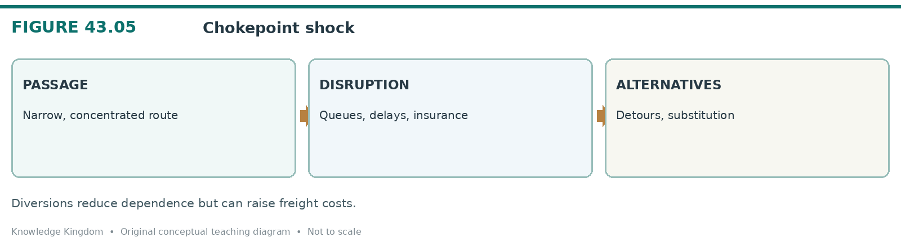

А точката на задушаване е тесен проход, през който много пътувания се събират. Суецкия канал свързва Средиземно и Червено море; Панамският канал свързва пътищата на Атлантическия океан и Тихия океан; пролива Малака се присъединява към Индийския океан с морските маршрути до Източна Азия; Хормуз свързва Персийския залив с Оманския залив; а турските проливи свързват Черно море със средиземноморската система. Тяхното стратегическо значение произтича от количеството и вида на движението, което те канализират.

Задушаващите точки не създават абсолютен контрол над световната икономика. Корабите могат да се отклоняват, тръбопроводите могат да заобикалят определени маршрути и държавите могат да коригират производството или съхранението. Отклоненията обаче отнемат време, консумират гориво, увеличават застрахователните разходи и преместват задръстванията другаде. Докладите на UNCTAD за морския транспорт показват как смущенията могат да увеличат броя на тон-милите, които са пътували дори когато общият обем на товара се променя малко.

Правителството с територия до точката на задушаване не разполага автоматично с неограничени права за спиране на чуждестранния трафик. Международните договори, транзитните режими, търговските стимули, военноморските възможности и отговорите на други държави са от значение. Важно е да се разграничат географското местоположение, правната юрисдикция, действителния оперативен контрол и възможността за влияние върху разходите за корабоплаване.

<figure class="figure" id="figure-43-5">

<figcaption>Фигура 43.5. Шокиращ шок. Отклоненията намаляват зависимостта, но могат да повишат разходите за товари. <a class="figure-anchor" href="#figure-43-5" aria-label="Link to this figure">#</a></figcaption>
</figure>
