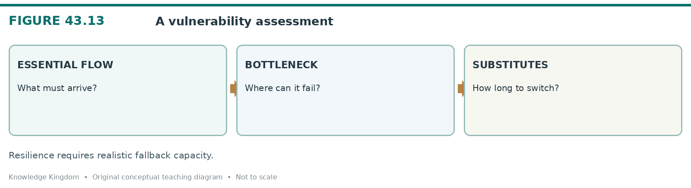

Държавата става уязвима, когато важна нужда разчита на маршрут, съоръжение, доставчик или решение, което не може лесно да замени. Това е по-полезна концепция, отколкото просто да броим сухопътните граници или километри от бреговата линия. Една добре свързана държава може да бъде издръжлива, ако има алтернативни маршрути; една държава с достатъчно ресурси може да бъде крехка, ако едно съоръжение за преработка доставя цялата си промишленост.

Практичният тест има четири стъпки. Първо, идентифицирайте основния поток: зърно, гориво, електричество, медицина, финанси или комуникация. Второ, намерете шишчето. Трето, прецени реалистичните заместители и колко време ще им отнеме да се активират. Четвърто, попитай кой ще понесе последствията от провала. След това правителствата следва да оценят цената на съкращенията срещу риска от прекъсване. Това са политически решения, които могат да бъдат оценени вместо обявени.

За хипотетичен пример, крайбрежна държава внася 60 процента от индустриален внос през едно пристанище. Вторият порт може да издържи само една четвърт от този поток при спешен случай. Незабавният недостиг може да бъде значителен, въпреки че държавата има дълга брегова ивица. Това е измислено упражнение; целта му е да покаже защо логистичният капацитет е по-важен от визуалната степен на функция на картата.

<figure class="figure" id="figure-43-13">

<figcaption>Фигура 43.13. Оценка на уязвимостта. Резистентността изисква реалистичен капацитет. <a class="figure-anchor" href="#figure-43-13" aria-label="Link to this figure">#</a></figcaption>
</figure>
