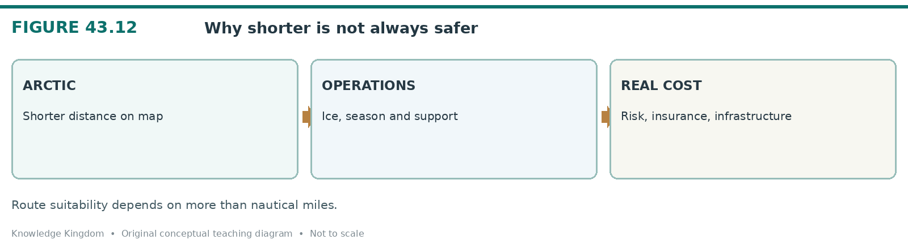

С промяната на условията за лед в Арктика, коментаторите понякога описват нова ера, в която северните маршрути автоматично ще заменят установените морски пътища. Това е твърде просто. Сезонен лед, непредсказуемо време, ограничени спасителни възможности, специализирани плавателни съдове, застраховки, пристанищни инфраструктури и екологични рискове усложняват операциите. По-краткото разстояние на картата не гарантира по-евтино или безопасно пътуване.

Арктика също така съдържа местни общности, чиито препитание, знания и права следва да бъдат от основно значение за дискусиите за развитие и сигурност. Конкуренцията над ресурсите, регулирането на корабоплаването и военната дейност е само част от историята. Опазването, научното сътрудничество, рибарството и местното участие също са от значение. Третирайки променящия се климат просто като стратегическа възможност, тя пропуска вредите и несигурността си.

Географите трябва да разграничават наблюдаваната екологична промяна от спекулативните геополитически прогнози. Маршрутът може да бъде плавателен при определени условия, без да е надежден за целогодишните търговски графици. Може да съществува маслен или минерален залеж, но остава неикономически или екологично неприемлив за извличане. Арктикът ни напомня, че технологията може да отвори възможности, докато природата и управлението продължават да ограничават възможното.

<figure class="figure" id="figure-43-12">

<figcaption>Фигура 43.12. Защо по-късо не винаги е по-безопасно. Възможността на маршрута зависи от повече от морски мили. <a class="figure-anchor" href="#figure-43-12" aria-label="Link to this figure">#</a></figcaption>
</figure>
