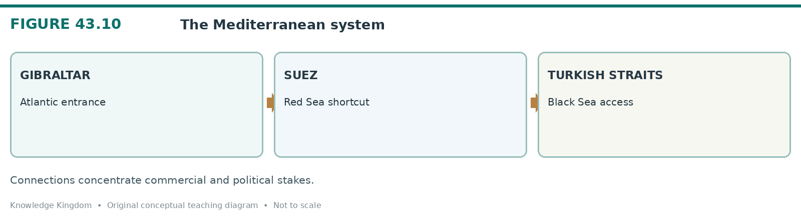

Средиземно море е затворено море, свързано с Атлантическия океан през Гибралтар и Червено море през Суецкия канал. Турските проливи свързват Черно море с по-широката морска система. Тези пасажи помагат да се обясни историческото значение на региона за търговията и сигурността, но морето не е единно стратегическо пространство. Неговите северни, южни и източни брегове съдържат общества с различни политически истории и икономически интереси.

Промяната на транспортната технология трансформира средиземноморската география. Преди Суецкия канал да бъде открит през 1869 г., търговията между Европа и Азия като цяло е била изправена пред различни разходи по морския път. Каналът направи един маршрут много по-кратък за много пътувания, създавайки нови търговски възможности и излагане на смущения. Неговата стратегическа значимост по-късно зависеше от корабните технологии, международните споразумения, участващите правителства и глобалните търговски модели.

Същият воден път може да бъде описан като портал или като уязвимост. Важното е кой разчита на маршрута, дали съществуват алтернативи и как смущенията засягат различни потребители. Географските дискусии за Средиземноморието следва да включват също крайбрежни общности, рибарство, миграция, екологични опасения и законни права на корабите и пътниците, а не само конкуренцията на външни моряци.

<figure class="figure" id="figure-43-10">

<figcaption>Фигура 43.10. Средиземноморската система. Връзките концентрират търговските и политическите залози. <a class="figure-anchor" href="#figure-43-10" aria-label="Link to this figure">#</a></figcaption>
</figure>
