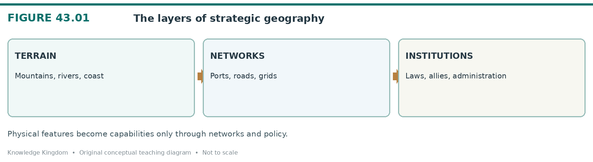

Мощността е способността да влияе на резултатите, но компонентите му се различават. Една държава може да притежава голяма армия, но все още няма капацитет за придвижване на тази армия. Тя може да контролира ценни минерали, но не може да ги обработва икономически. Една малка държава може да повлияе на международното договаряне, защото важен пристанищен, финансов или комуникационен възел се намира на нейна територия. Така териториалният размер и стратегическото влияние не са синоним.

Отличи ресурси от възможности и възможности от резултати. Планината е географска характеристика; тунелът е инфраструктура; способността да се управлява тунела надеждно е институционален капацитет. Летището е полезно само когато са налице самолети, техници, гориво, сигурен достъп и политическо разрешение. Същият обект може да бъде търговски актив в мирното време и логистична уязвимост във войната. Властта включва и легитимност: правителството не може просто да третира жителите на долината като взаимозаменяеми точки на картата.

Полезна аналитична последователност е местоположение, достъп, мрежа, контрол, разходи и избор. Последователността насърчава точните въпроси. Къде е бонусът? Кой може да го достигне? От кои системи зависи? Кой всъщност контролира тези системи? Какви алтернативи съществуват? Кои политики биха могли да променят резултата? Това е основата на всеки географски случай, който следва.

<figure class="figure" id="figure-43-1">

<figcaption>Фигура 43.1. Слоеве на стратегическа география. Физическите характеристики се превръщат в възможности само чрез мрежи и политика. <a class="figure-anchor" href="#figure-43-1" aria-label="Link to this figure">#</a></figcaption>
</figure>
