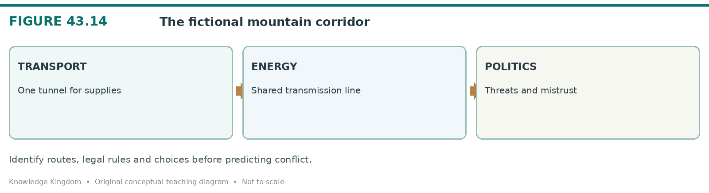

Върнете се в нашата откриваща измислена страна. Две щата споделят планински коридор, съдържащ един тунел, водопровод и пътен транспорт на лекарства и храна. Един граничен инцидент кара една държава да заплаши затварянето. Другият обявява военни учения наблизо. Публичните аргументи описват тунела като исторически национален спасителен пояс. Физическата география е ясна; кризата произтича от взаимодействието между икономическите, сигурността и политическите фактори.

Започни с картиране на потоците. Кой използва пътя? Има ли алтернативни пътища? Може ли електрическата линия да бъде поправена бързо? Дали зимните условия влияят на достъпа? Следваща карта на институциите: кой управлява тунела, събира такси, издава разрешителни и наблюдава инциденти? Накрая идентифицирайте лицата, вземащи решения, и стимулите. Ако всяко правителство се опасява, че концесията ще предизвика бъдещ натиск, това е проблем с обвързването. Ако командирите интерпретират поправките като подготовка за атака, това може да е и дилема на сигурността.

Възможните мерки включват съвместни инспекции, неутрален мониторинг, правила за аварийни транзити, излишни енергийни връзки и надеждни процедури за разрешаване на спорове. Никой не гарантира мир, но всеки се обръща към определен механизъм. Примерът показва как географският анализ може да подкрепи практическите преговори, а не просто да предвижда конфликти.

<figure class="figure" id="figure-43-14">

<figcaption>Фигура 43.14. Измисленият планински коридор. Идентифициране на маршрути, правни правила и избори, преди да се предвиди конфликт. <a class="figure-anchor" href="#figure-43-14" aria-label="Link to this figure">#</a></figcaption>
</figure>
