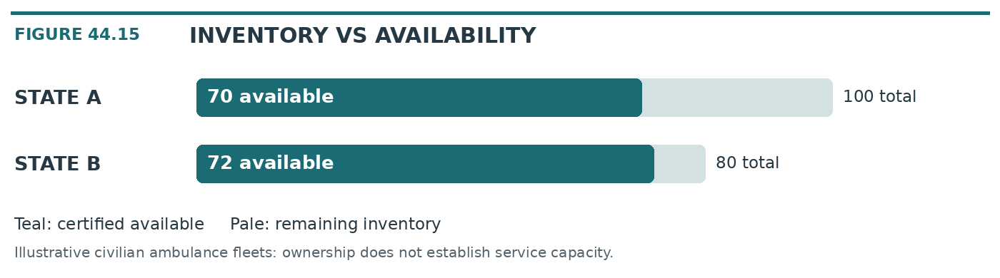

Върнете се към измислените състояния при отварянето на главата. Вместо да си представят битка, сравнете техните флотилии за спешна помощ. Държавата А притежава 100 линейки, от които 70 са сертифицирани като налични за обичайните им задължения на определена дата на докладване. Държавната Б притежава 80, от които 72 са сертифицирани като налични съгласно същото определение. А има по-голям инвентар, но Б има малко повече свободни линейки. Степента на наличност на А е 70, делено на 100 или 70 процента; В е 72, разделено на 80 или 90 процента.

Има ли Б по-добра спешна помощ? Няма достатъчно информация. Превозните средства могат да обслужват различни популации, да имат различни условия за наемане на персонал и да пътуват на различни разстояния. Снимането не показва нищо пряко за времето за реагиране, медицинските резултати, предимството на услугите или устойчивостта на системата по време на бедствие. Въпреки това тя излага на риск грешката да се изравни собствеността с използваем капацитет. Същото логично предупреждение важи и за публикуваните военни запаси.

Сега да предположим, че А изразходва 120 милиона валутни единици годишно и Б харчи 100 милиона. Все още не можем да определим сравнителната ефективност: разходите включват различни разходи, а географските и демографските изисквания на всяка услуга се различават. Урокът е да се определи съответният резултат, да се изберат сравними показатели и да се следи несигурността. Тези цифри са изцяло измислени и засягат гражданските служби, а не прогнозите за действителните военни изисквания.

<figure class="figure" id="figure-44-15">

<figcaption>Фигура 44.15. Илюстративни цивилни линеен флот: собствеността не установява капацитет за обслужване. <a class="figure-anchor" href="#figure-44-15" aria-label="Link to this figure">#</a></figcaption>
</figure>
