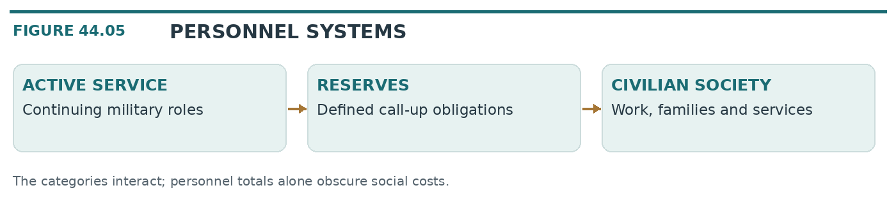

Активният персонал продължава да изпълнява военни функции; запасителите имат задължения или ангажименти, които им позволяват да бъдат призовани при определени условия. Правните договорености се различават по държави. Мобилизацията е по-широк процес, чрез който държавата активира персонала, институциите и ресурсите в отговор на национално изискване. Това не е просто още една дума за набиране на персонал.

Да разгледаме една медицинска сестра, железопътен инженер и специалист по софтуер, който има задължения за резерви. Цивилната им окупация може да е от съществено значение за същото общество, което ги призовава към военна служба. Преместването на голям брой хора в една институция може да остави друг недостиг на персонал. Това създава труден икономически и социален въпрос: как една страна трябва да отделя оскъдни човешки умения, като същевременно поддържа здравеопазването, производството и обществените услуги?

Общата сума на резервите не е подходяща мярка за готовност. Датата на последното обучение, профила на здравеопазването и възрастта, правната допустимост и административните документи са от значение. Мобилизацията включва и публично съгласие, компенсация, семейни отговорности и права на физическите лица. Държавите се различават по начина, по който разпространяват тези тежести. Тези въпроси свързват военната организация със социалната държава, трудовите пазари и конституционното право, а не само с военната история.

<figure class="figure" id="figure-44-5">

<figcaption>Фигура 44.5. Категориите си взаимодействат; персоналът сам по себе си замъглява социалните разходи. <a class="figure-anchor" href="#figure-44-5" aria-label="Link to this figure">#</a></figcaption>
</figure>
