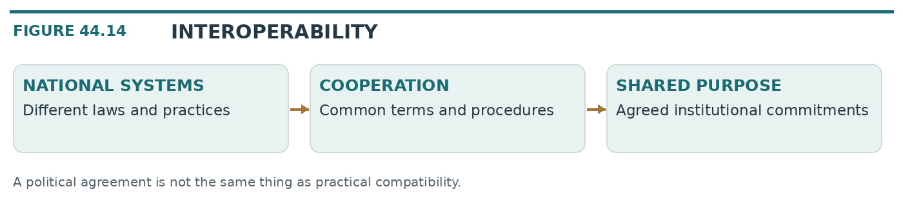

Съюзът е политическо споразумение между държавите; мултинационална военна институция трябва също така да се справи с практическите различия в езика, процедурите, правната власт, обществените поръчки и администрацията. Оперативната съвместимост описва способността на организациите да работят ефективно заедно. Тя не изисква всички участници да притежават еднакво оборудване или политически предпочитания.

Публикуваният подход на НАТО към логистиката подчертава сътрудничеството между членовете, институционалните отговорности, гражданската готовност и съвместимостта. Държавите-членки запазват важни национални отговорности, докато участват в колективните договорености. Това са обявени политики на съюза, а не доказателство, че всички проблеми на сътрудничеството са решени на практика. Критичният читател следва да разграничи документа на политиката от доказателствата за неговото прилагане. \[<a href="/044-military-organization-and-logistics/sources/#source-25" class="cite">25</a>\]\[<a href="/044-military-organization-and-logistics/sources/#source-26" class="cite">26</a>\]\[<a href="/044-military-organization-and-logistics/sources/#source-27" class="cite">27</a>\]

Многонационална мирна операция дава още един пример. Условията на Организацията на обединените нации определят условията за персонала, оборудването, услугите и възстановяването на разходите, предоставяни от участващите държави. ООН зависи от тези правителства за униформен персонал, а не от притежаването на постоянна национална армия. Следователно различните национални институции трябва да работят в рамките на общите договорености за мисията. \[<a href="/044-military-organization-and-logistics/sources/#source-28" class="cite">28</a>\]\[<a href="/044-military-organization-and-logistics/sources/#source-29" class="cite">29</a>\] Глава 45 ще разгледа дипломатическите ангажименти зад съюзите, а глава 50 се връща към мирните операции и възстановяването.

<figure class="figure" id="figure-44-14">

<figcaption>Фигура 44.14. Политическото споразумение не е същото като практическата съвместимост. <a class="figure-anchor" href="#figure-44-14" aria-label="Link to this figure">#</a></figcaption>
</figure>
