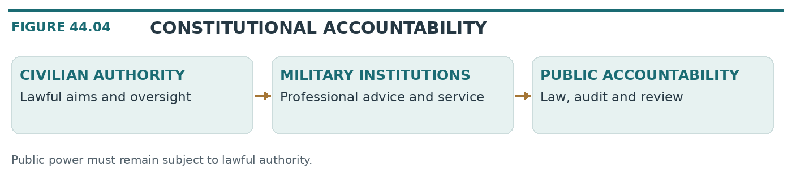

Въоръжените сили имат правомощия, които биха били изключителни в повечето обществени организации. В конституционната демокрация гражданският контрол поставя тези правомощия под законна политическа власт. Избрани представители и ръководители определят обществената политика в рамките на съответните си конституционни отговорности; военни специалисти съветват и управляват средствата, които са им възложени. Гражданският надзор може да включва бюджети, законодателство, назначения, одит, съдилища и парламентарни комисии.

Цивилният контрол не означава, че избраните политици трябва лично да вземат всяко техническо решение. Нито професионалната военна експертиза дава право на офицерите да изместят цивилните власти. И двете страни са изправени пред задължения: политическите органи трябва да формулират съгласувани законни цели, докато военните институции трябва да дават откровени оценки, да спазват законните заповеди и да останат отговорни. Конституцията може да създаде стабилно формално разделение, докато действителната практика не е достатъчна.

Въпросът е особено важен след революция, военно поражение или политически срив. Въоръжените институции могат да твърдят, че тяхното организационно сближаване им дава право да управляват. Но компетентността при администрирането на въоръжена сила не създава право на управление на обществото. Принципът на граждански контрол има за цел да гарантира, че обществените военни остават средство за законно управление, а не правителството да се превърне в средство на военните. \[<a href="/044-military-organization-and-logistics/sources/#source-4" class="cite">4</a>\]\[<a href="/044-military-organization-and-logistics/sources/#source-5" class="cite">5</a>\]

<figure class="figure" id="figure-44-4">

<figcaption>Фигура 44.4. Обществената власт трябва да остане подчинена на законната власт. <a class="figure-anchor" href="#figure-44-4" aria-label="Link to this figure">#</a></figcaption>
</figure>
