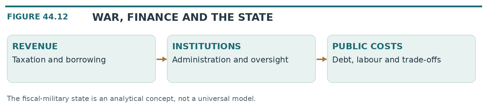

Ранните модерни правителства все повече се сблъскват с финансовата тежест на дългите войни, укрепленията, професионалните военни заведения и военноморската конкуренция. Способността им да облагат, заемат и управляват разходи се превърна във важна част от междущатското съперничество. Някои историци описват взаимодействието между фискалните институции и военната организация чрез концепцията за фискалната-военна държава. \[<a href="/044-military-organization-and-logistics/sources/#source-17" class="cite">17</a>\]\[<a href="/044-military-organization-and-logistics/sources/#source-18" class="cite">18</a>\]

Публичните заеми могат да разпределят разходите за конфликт през следващите години, докато данъчното облагане свързва въоръжените сили със земеделските стопани, търговците и градските домакинства. Финансовата надеждност зависи от институциите, които могат да събират приходи и да изпълняват задължения. Въпреки това развитието на по-силни фискални институции не винаги е произвеждало представително правителство или справедливо данъчно облагане. Войната може да разшири държавната власт, да задълбочи дълга и да засили принуда.

Османската империя осигурява поучително сравнение. Неговите ранни съвременни военни институции са били вградени в общество, простиращо се в Югоизточна Европа, Анатолия, Близкия изток и Северна Африка. Rhoads Murpheys проучване на Османската война между 1500 и 1700 места фискални задължения, осигуряване, транспорт, материални ограничения и опит на обикновени войници в тази по-широка политическа икономика. Читател, който съди османската държава само с териториалното си разширяване или с резултатите от известни ангажименти, пропуска институциите и труда, които правят тези постижения възможни. \[<a href="/044-military-organization-and-logistics/sources/#source-37" class="cite">37</a>\]

Концепцията също има граници. Тя се появи до голяма степен от стипендия за европейски опит; тя трябва да се използва сравнително, а не като шаблон, който всяко общество следваше. Османските, Мугалските и Цинските светове разработиха свои собствени договорености за събиране на приходи, администриране на територия и мобилизиране на хора. Глава 30 изследва своите отличителни политически институции. Военната организация трябва да бъде разположена в рамките на конкретната икономическа и социална структура на всяка държава, а не измервана от това колко близко прилича на идеализиран европейски модел.

Сравнение от осемнадесети век е разширяването на империята Цин в Централна Евразия. Изследването на Цин "Перу" подчертава комбинацията от военни действия, икономически инвестиции, дипломация и администрация. Поражението на колонията Зунгхар бе придружено от включването на обширни гранични територии и жестоко насилие срещу засегнатите популации. Разширяването на имперското управление включвало много повече от успешна поредица от кампании: трайната власт изисквала институциите да управляват хора и територии и включвала избор за принуда, настаняване и търговия. Тази история илюстрира по-широката разлика между военното постижение и политическото изграждане на империя. Напомня ни също, че същите процеси, които укрепват една държава, могат да унищожат сигурността и автономията на други общества. \[<a href="/044-military-organization-and-logistics/sources/#source-38" class="cite">38</a>\]

<figure class="figure" id="figure-44-12">

<figcaption>Фигура 44.12. Фискално-военната държава е аналитична концепция, а не универсален модел. <a class="figure-anchor" href="#figure-44-12" aria-label="Link to this figure">#</a></figcaption>
</figure>
