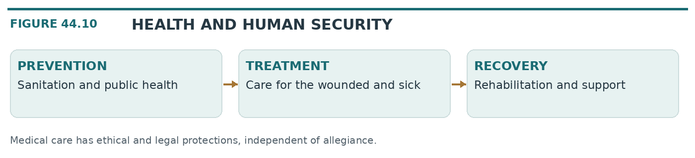

Военната история е неделима от медицината. Инфекция, замърсена вода, недохранване, изтощение, климат, инциденти и психологическа травма засягат всички хора. Исторически източници могат да записват имената на битките по-внимателно от условията, при които е живял обикновеният персонал, създавайки изкривена картина на причините за болестите и страданията.

Общественото здраве, хигиената и медицинските институции се променили значително през деветнадесети и двадесети век. По-доброто разбиране за пренасянето на болести, ваксинирането, хигиената и хирургията преобразиха много общества. Но медицинският прогрес не премахва човешката уязвимост. Въоръженият конфликт също вреди на гражданските здравни системи точно когато нуждата от тях стане по-голяма. Разместването и загубата на доходи могат да причинят вреди, които продължават дълго след падането на прякото насилие.

Медицинските служби имат правен и етичен статут, различен от обикновената военна дейност. Международното хуманитарно право изисква защита и грижи на ранените и болните хора съгласно приложимите правила, включително тези от възразяваща страна. Медицинският персонал, звената и транспортът получават специални предпазни мерки при спазване на съответните правни условия. Целта на медицината е грижа, а не политическа или военна принадлежност. Връщаме се към тези задължения в глава 46. \[<a href="/044-military-organization-and-logistics/sources/#source-12" class="cite">12</a>\]\[<a href="/044-military-organization-and-logistics/sources/#source-13" class="cite">13</a>\]

<figure class="figure" id="figure-44-10">

<figcaption>Фигура 44.10. Медицинската грижа има етични и правни защити, независими от вярност. <a class="figure-anchor" href="#figure-44-10" aria-label="Link to this figure">#</a></figcaption>
</figure>
