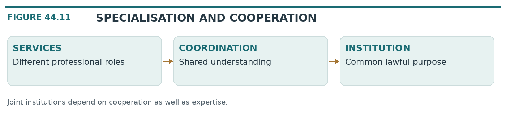

Терминът съвместно по принцип се отнася до сътрудничество между различни военни служби, като наземни, морски и въздушни институции. Комбинираните оръжия се отнасят по-тясно до интеграцията на различни видове военни способности. В многонационални контексти, комбинирани могат да опишат и сили от различни държави. Тези значения не трябва да се свиват.

Специализацията дава възможност на хората и институциите да развият опит, който би бил невъзможен, ако всеки човек трябваше да изпълнява всяка задача. Специализацията също така създава разходи за координация. Организациите развиват различни култури, професионални речници, оборудване и бюджетни приоритети. Правителството може да установи, че институционалните граници насърчават отделите да оптимизират собствените си резултати, като пренебрегват по-широката обществена цел.

Принципът може да бъде илюстриран чрез реакция при бедствия, включваща инженери, медицински персонал в спешни случаи, полиция, транспортни оператори и местни органи. Всеки изпълнява различна законова функция; приносът на цялата организация зависи от способността да ги координира. Във военната история технологичните иновации често увеличават значението на тези институционални отношения. Изследването на организационното сътрудничество не трябва да се бърка с предположението, че всички военни институции могат да бъдат класирани единствено чрез изтънчеността на тяхната технология.

<figure class="figure" id="figure-44-11">

<figcaption>Фигура 44.11. Съвместните институции зависят от сътрудничеството, както и от експертния опит. <a class="figure-anchor" href="#figure-44-11" aria-label="Link to this figure">#</a></figcaption>
</figure>
