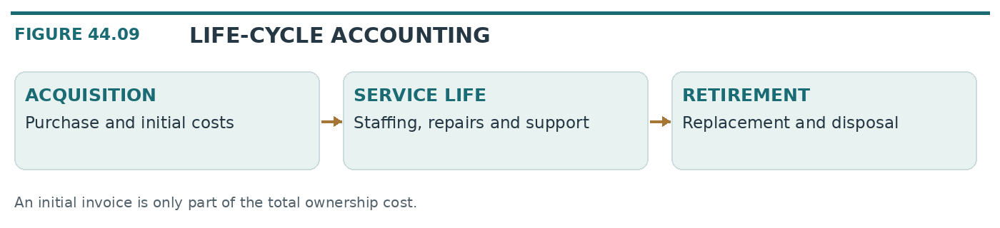

Всяка машина е остаряла. Компоненти носят, софтуерът става остарял, и специализирани инструменти или квалифицирани работници могат да станат недостъпни. Придобиването е процес на придобиване на актив; поддържането включва дейностите, необходими за поддържане на функционирането му над планирания му трудов живот. Поради това ниската покупна цена може да бъде придружена от високи дългосрочни разходи.

През 2024 г. Службата за отчетност на правителството на САЩ проучи как отбранителните институции отчитат промени в оперативните и поддържащите разходи на големите системи. Анализът му подчертава важността на последователните записи и отчетността пред Конгреса. Отделните проучвания на GAO на въздухоплавателните средства и наземните превозни средства показват, че докладваната готовност може да варира в зависимост от възрастта, поддръжката и наличието на части. Това са одити на определени американски институции, а не универсални формули за всяка армия. \[<a href="/044-military-organization-and-logistics/sources/#source-9" class="cite">9</a>\]\[<a href="/044-military-organization-and-logistics/sources/#source-10" class="cite">10</a>\]\[<a href="/044-military-organization-and-logistics/sources/#source-11" class="cite">11</a>\]

Да разгледаме два измислени договора за автобус. Един доставчик предлага по-евтини автомобили, но скъпо обслужване на собственост; друг предлага по-скъпи превозни средства с широко достъпна подкрепа. Отговорният публичен купувач сравнява целия период на собственост, а не само фактурата. Аналогията е особено важна, когато се четат съобщения за военна модернизация. Закупуването може да създаде финансови задължения за много бъдещи правителства, включително обучение, обслужване, съоръжения и евентуално обезвреждане.

<figure class="figure" id="figure-44-9">

<figcaption>Фигура 44.9. Първоначалната фактура е само част от общите разходи за собственост. <a class="figure-anchor" href="#figure-44-9" aria-label="Link to this figure">#</a></figcaption>
</figure>
