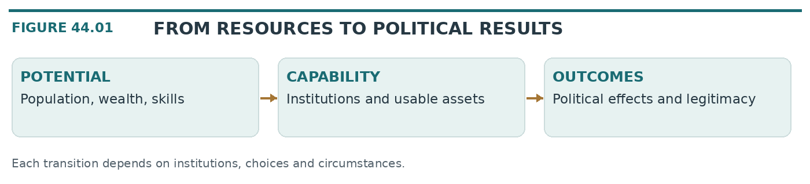

Населението на една страна, икономическата продукция, природните ресурси и технологиите са източници на потенциална енергия. Военната способност е способността на въоръжените сили да изпълняват конкретни задачи при определени условия. Политическата власт е по-широк капацитет за влияние върху резултатите. Тези три идеи са свързани, но преходът между тях не е автоматичен. Богата държава може да няма необходимите институции, за да превърне парите в компетентни обществени услуги; на ефективна въоръжена сила може да бъде дадена цел, която само военната сила не може да постигне.

Да разгледаме разликата между защитата на въздушното пространство на дадена държава, приноса на персонала към мироопазващата мисия и поддържането на дългосрочно присъствие в чужбина. Един и същ персонал и оборудване не е задължително да отговарят и на трите. Следователно способността е релационна концепция: тя трябва да се разглежда срещу определена задача, околна среда и опонент или опасност. Маса в лигата, която дава по един постоянен ранг на военните във всяка страна, замъглява това важно разграничение.

Ресурсите трябва да преминават през образование, възлагане на обществени поръчки, обучение, администрация и поддръжка, преди те да станат надеждни възможности. Окончателното превръщане в политически резултати зависи от законната власт, дипломацията, реакцията на други участници и предпочитанията на засегнатите народи. Държавата може да спечели военни срещи, но не и стабилен мир. Това не е противоречие; то не различава средствата от краищата. \[<a href="/044-military-organization-and-logistics/sources/#source-2" class="cite">2</a>\]\[<a href="/044-military-organization-and-logistics/sources/#source-3" class="cite">3</a>\]

<figure class="figure" id="figure-44-1">

<figcaption>Фигура 44.1. Всеки преход зависи от институции, избори и обстоятелства. <a class="figure-anchor" href="#figure-44-1" aria-label="Link to this figure">#</a></figcaption>
</figure>
