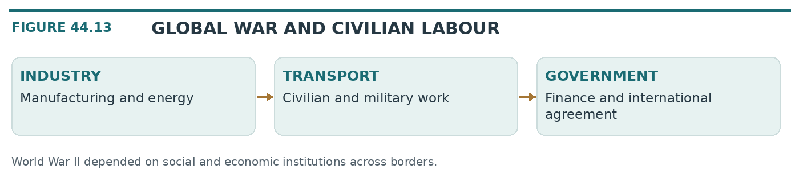

Втората световна война включваше огромни мрежи от промишленост, труд, морска търговия, публични финанси и международно сътрудничество. Съединените щати и Великобритания трябваше да координират стратегическите приоритети в много региони, докато Съветският съюз преживя огромно унищожение и реорганизира голяма част от индустриалната си дейност. Азиатските общества са изправени пред окупация, принуда, съпротива и нарушаване на търговията в огромен мащаб. Глава 40 изследва по-широката политическа и човешка история на войната.

Американската официална история на военната логистика подчертава как съюзното сътрудничество усложнява и дава възможност за разпределяне на ресурсите. Те осигуряват богат институционален рекорд, въпреки че тяхната перспектива трябва да бъде допълнена от други национални и цивилни истории. Доставката или фабриката е била значителна само във връзка с по-широките политически и икономически договорености. Съюзническите военни усилия включваха търговски морски лица, железопътни работници, докери и индустриални служители, както и военен персонал. \[<a href="/044-military-organization-and-logistics/sources/#source-21" class="cite">21</a>\]\[<a href="/044-military-organization-and-logistics/sources/#source-22" class="cite">22</a>\]

The Red Ball Express през 1944 г. е една историческа илюстрация за значението на транспортния труд, включително приноса на африканските американски войници, служещи в отделна американска армия. Епизодът не трябва да се свежда до изобретателността на няколко командира. Неговата по-широка история свързва военновременната институционална организация с расовото неравенство и разпределението на кредитите за обществени постижения. \[<a href="/044-military-organization-and-logistics/sources/#source-23" class="cite">23</a>\]

<figure class="figure" id="figure-44-13">

<figcaption>Фигура 44.13. Втората световна война зависеше от задграничните социални и икономически институции. <a class="figure-anchor" href="#figure-44-13" aria-label="Link to this figure">#</a></figcaption>
</figure>
