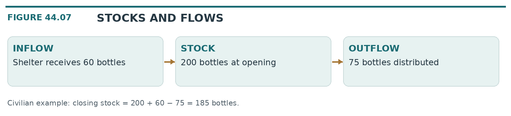

Глава 7 въвежда разграничението между запасите и потоците. Запасът е натрупано количество в определен момент, докато потокът е количество, влизащо или напускащо система през интервал. Аварийно убежище може да има бутилирана вода в склад (склад), доставки от доставчици (входящ) и вода, разпределени на жителите (поток). Ако тегленията постоянно надвишават доставките, акциите падат дори когато първоначално складът изглежда пълен.

Това просто разграничение е необходимо за тълкуването на военните икономики. Военният инвентар е запас. Индустриалното производство и обществените поръчки са потоци. Голяма инвентаризация може да отразява десетилетия по-ранни разходи и да говори малко за настоящия производствен капацитет. От друга страна, икономиката, която произвежда стоки постоянно, първоначално може да притежава по-малък запас. Публичните статистически данни също се различават по броя им: собствеността, разрешеното разпределение, физическото присъствие и използваемото състояние не са взаимозаменяеми.

Второто разграничение е между производството на стока и нейната достъпност до институцията, която се нуждае от нея. Стоките могат да очакват проверка, ремонт, забавяне на транспортирането или неподходящо за тяхната цел. Броенето на една и съща точка на няколко етапа може да доведе до илюзия за изобилие. Системата следва да се разбира по-скоро като свързана дейност, отколкото като впечатляващо обобщено количество.

<figure class="figure" id="figure-44-7">

<figcaption>Фигура 44.7. Цивилен пример: затваряне на запаса = 200 + 60 − 75 = 185 бутилки. <a class="figure-anchor" href="#figure-44-7" aria-label="Link to this figure">#</a></figcaption>
</figure>
