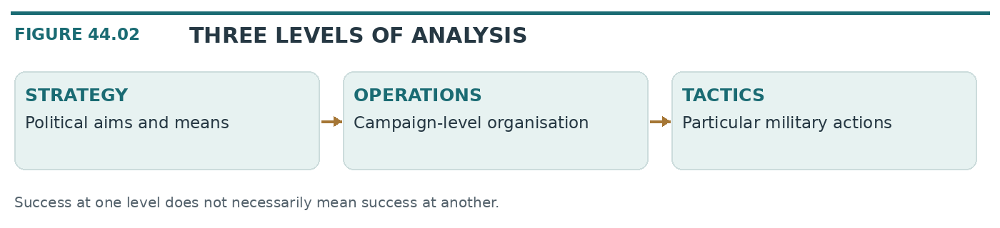

Военното писане често отличава три нива на анализ. Стратегията засяга отношенията между политическите цели и средствата, използвани за тяхното преследване. Оперативното ниво се отнася до това как военните дейности са организирани в рамките на по-широка кампания или театър. Тактиката се отнася до конкретни военни ангажименти и действия. Това са аналитични отличия, а не три етажа на сграда, чиито обитатели никога не си говорят.

Успешното местно действие може да има малка политическа стойност; малък инцидент може да има огромни международни последици. Операция, която изглежда съгласувана на военна карта, може да подкопае преговорите или да надхвърли правомощията, предоставени първоначално от правителството. Затова политическото равнище трябва да бъде в състояние да преразгледа целите си в светлината на събитията, а не просто да изисква по-големи усилия от дадена институция.

Помислете за разликата между стратегията на футболния клуб за сезона, организацията на мениджъра на поредица от мачове и решенията, взети в индивидуален мач. Аналогията помага да се изясни мащабът, но войната не е спорт: последиците от нея включват смърт, преместване, правни задължения и евентуално унищожаване на политическите общности. Ние използваме трите нива, за да тълкуваме историята, а не да приемаме, че по-сръчното насилие непременно води до по-добър политически резултат.

<figure class="figure" id="figure-44-2">

<figcaption>Фигура 44.2. Успехът на едно ниво не означава непременно успех на друго. <a class="figure-anchor" href="#figure-44-2" aria-label="Link to this figure">#</a></figcaption>
</figure>
