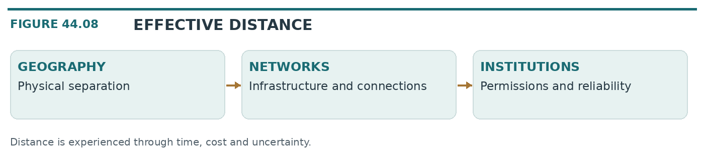

Предишната глава отличава физическото разстояние от ефективно разстояние. Един километър през надеждна транспортна мрежа се различава от километър през труден терен или слабо свързана граница. Транспортът също има правни и административни размери: превозни средства, товари и хора преминават юрисдикция, а разрешения или митнически процеси могат да повлияят на надеждността на пътуванията.

Кораби, железопътни линии, пътни превозни средства и въздухоплавателни средства предоставят различни видове транспортни услуги. Корабите пренасят голяма част от световната международна търговия; железниците могат да свързват големи наземни пазари; пътищата свързват разпръснати общности; въздушният транспорт е особено ценен, когато времето е критично. Всяка от тях е част от по-голяма система, включваща терминали, работници, поддръжка, регулации и връзки с други видове транспорт.

Историческите разкази понякога разглеждат появата на нова транспортна технология, сякаш тя незабавно елиминира по-старата. В действителност, нови и стари форми често съществуват съвместно. Железопътните линии през индустриалната ера зависели от пътища, животни и хора, които да свързват места извън железопътните гари. Съвременният транспорт зависи от инфраструктурата, наследена от по-ранните поколения. Географията се трансформира от институции и технологии, а не от тях. \[<a href="/044-military-organization-and-logistics/sources/#source-7" class="cite">7</a>\]\[<a href="/044-military-organization-and-logistics/sources/#source-8" class="cite">8</a>\]

<figure class="figure" id="figure-44-8">

<figcaption>Фигура 44.8. Разстоянието се изпитва чрез време, цена и несигурност. <a class="figure-anchor" href="#figure-44-8" aria-label="Link to this figure">#</a></figcaption>
</figure>
