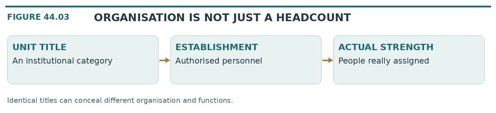

Военните институции разделят отговорностите си на по-малки организации, за да направят възможно надзора, администрацията и колективните действия. Познати наземна сила етикети включват отряд или секция, взвод, компания, батальон, бригада, дивизия и корпус. Образуването обикновено е по-голямо групиране на подчинени организации, въпреки че терминологията варира. Военноморските и въздушните организации използват собствени етикети. Полкът може да има административна или церемониална роля в една система и различна организационна функция в друга.

Избягвайте да запомняте една таблица с размери на единиците, сякаш се е прилагала през цялата история. Батальон в една страна не е непременно идентичен с батальона в друга. Упълномощеното му предприятие може да се различава от действителната си сила. Два екипа със същото име могат да имат различен специализиран персонал и оборудване. Историческите формации могат да запазят впечатляващи титли дори и след съществени промени в състава им.

Ранг е официална позиция на лице в рамките на военната йерархия; назначаването описва определена работа или отговорност. Двамата са свързани, но не са идентични. Командирът има делегирани правомощия; служителят на персонала може да има широко професионално влияние, без лично да командва всички хора, засегнати от техните съвети. Тези различия обясняват защо докладите за генерали, бригади или дивизии трябва да се четат с внимание към институционалния контекст, вместо да се разглеждат като самообяснени номера.

<figure class="figure" id="figure-44-3">

<figcaption>Фигура 44.3. Идентични заглавия могат да прикрият различни организации и функции. <a class="figure-anchor" href="#figure-44-3" aria-label="Link to this figure">#</a></figcaption>
</figure>
