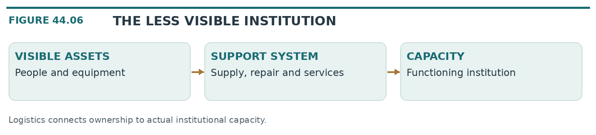

Логистиката се отнася до движението и предоставянето на хората, стоките и услугите, изисквани от дадена организация. Военната логистика включва транспортни, доставки, съхранение, поддръжка и други спомагателни функции; поддържането често се използва за по-широката дейност на поддържане на сила и нейните услуги с течение на времето. Ученическите определения варират, така че нито един термин не трябва да се третира като имащ една универсално фиксирана граница.

Полезно сравнение е селски магазин за хранителни стоки. Рафтовете са най-видимата част от бизнеса, но магазинът изисква и доставчици, доставки, охлаждане, паричен поток, електричество, работници и инвентарни архиви. Да притежаваш хладилник не е достатъчно, ако той не може да бъде поправен или захранван. Поръчка от доставчик не е същата като получената и достъпна за продажба стока. По същия начин, съществуването на военно оборудване ни говори малко за по-широката система, която я прави използваема.

Военен историк Мартин ван Кревелд прави проблема с доставките и движението централно за неговото изследване на кампании от началото на съвременна Европа нататък. Подходът му е ценен, защото той пренасочва вниманието от това, което командирите искат да направят, към това, което техните институции биха могли да подкрепят. Това не е универсална теория, която прави всяко друго обяснение ненужно. Политическата преценка, лидерството, географията, технологиите и действията на противниците остават от значение. \[<a href="/044-military-organization-and-logistics/sources/#source-1" class="cite">1</a>\]\[<a href="/044-military-organization-and-logistics/sources/#source-6" class="cite">6</a>\]

<figure class="figure" id="figure-44-6">

<figcaption>Фигура 44.6. Логистиката свързва собствеността с действителния институционален капацитет. <a class="figure-anchor" href="#figure-44-6" aria-label="Link to this figure">#</a></figcaption>
</figure>
