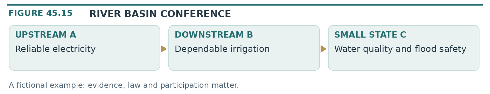

Три измислени правителства споделят един речен басейн. Нагоре по веригата А иска надеждна електроенергия; надолу по течението Б иска надеждно напояване; малко С иска чиста питейна вода и защита от наводнения. А обявява нов инфраструктурен проект. Твърди, че проектът заплашва земеделските стопани; отговори, че има суверенно право на развитие. C иска регионална конференция. Фактите за сезонните потоци остават спорни. Не е представен реален сценарий за държава или армия.

Опростен анализ етикети А агресивни и B отбраната, или предполага, че и двете позиции са еднакво оправдани. По-добър анализ разделя въпроси: какво показват хидрологичните доказателства; какви правила вече управляват басейна; кой има правомощия да преговаря; кои общности поемат разходите; и какви резултати може да приеме всяко правителство? Една научна група може да помогне за изясняването на фактическите спорове. Един посредник може да помогне за организирането на дискусия. Нито една институция не определя кое е справедливо.

Конференцията може да се съгласи за споделено наблюдение, като остави неразрешени разпределения. Това би било частично постижение, а не окончателно споразумение. Последващото споразумение би могло да установи прозрачни процедури за сезонни промени и консултации, при спазване на приложимото право. Ако правителствата не могат да получат национално одобрение, международното споразумение може да остане нереализирано. Оценката на процеса изисква доказателства за изпълнението с течение на времето, а не само снимка на церемонията по подписването.

<figure class="figure" id="figure-45-15">

<figcaption>Фигура 45.15. Въображаем пример: доказателствата, закона и участието са важни. <a class="figure-anchor" href="#figure-45-15" aria-label="Link to this figure">#</a></figcaption>
</figure>
