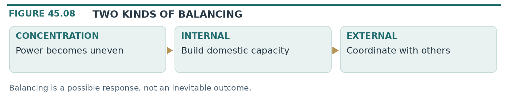

Фразата баланс на властта има няколко значения. Тя може да опише как възможностите се разпределят между държавите; тя може да се отнася до политика, предназначена да предотврати господство; или тя може да назове теория предвиждаща, че държавите ще устоят на концентрации на власт. Тези значения не бива да се струпват един в друг. Разпределението може да бъде неравномерно, докато правителствата следват балансиращи политики. Политиката може да се провали дори ако основната теория помага да се обясни защо е била избрана. \[<a href="/045-diplomacy-alliances-and-balance-of-power/sources/#source-12" class="cite">12</a>\]

Да предположим, че четири хипотетични страни притежават сравними ресурси. Единият става много по-силен от другия. Някои съседи могат да увеличат собствените си възможности, да се координират помежду си или да търсят външна подкрепа. Вътрешното балансиране се отнася до укрепване на вътрешния капацитет; външното балансиране включва сътрудничество с други. Нито един процес не изисква равенство във всяка категория. Държавите могат да бъдат силни във финансите, технологиите или географията и слаби в други отношения.

Балансирането е възможен отговор на концентрацията, а не закон, който автоматично създава мир. Ако правителствата интерпретират погрешно поведението си, усилията им да се защитят могат да увеличат напрежението. Ако те не могат да си сътрудничат, най-силната държава може да остане доминираща. По-малките щати могат дори да приветстват мощен защитник. Анализаторът трябва да проучи защо актьорите тълкуват разпределението на властта по определен начин, вместо да приема, че само аритметиката определя политиката.

<figure class="figure" id="figure-45-8">

<figcaption>Фигура 45.8. Балансирането е възможен отговор, а не неизбежен изход. <a class="figure-anchor" href="#figure-45-8" aria-label="Link to this figure">#</a></figcaption>
</figure>
