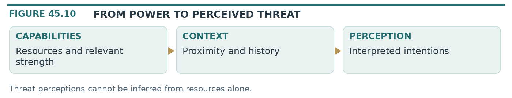

Подходът на Стивън Уолт за баланс на заплахата твърди, че подравняването отговаря на възприеманите заплахи, а не само на общата власт. В своя разказ, общата сила, близостта, нападателната способност и възприеманите намерения допринасят за заплахата. Една далечна могъща страна може да изглежда по-малко опасна от по-слаб съсед с враждебни териториални претенции. \[<a href="/045-diplomacy-alliances-and-balance-of-power/sources/#source-13" class="cite">13</a>\]

Това обяснява защо не може да се намесят съюзи само от брутния вътрешен продукт или военните разходи. Посоката на политиката на едно правителство може да зависи от тълкуването на историята, предишните ангажименти и доверието, което то поставя в определени институции. Възприятията могат да бъдат погрешно или политически манипулирани. Правителството може да представи конкурента си като заплашващ да консолидира вътрешната подкрепа; друг може да пренебрегне надеждните предупреждения, защото неговите лидери смятат, че конкурентът е доброкачествен.

Теорията генерира въпроси за разследване, а не заключения, които да се приемат. Каква потенциална заплаха всъщност описаха властите? Поверителни записи съвпадат ли с публични речи? Съперническите правителства също ли бяха загрижени? Дали политиката се е променила, когато възможностите са се променили или когато лидерите са преразгледали очакванията си? Доказателствата за възприятията на заплахата помагат да се разграничат конкурентните обяснения. То не оправдава поведението на една държава само защото нейните лидери твърдят, че се чувстват застрашени.

<figure class="figure" id="figure-45-10">

<figcaption>Фигура 45.10. Възприятията на заплахата не могат да бъдат изведени само от ресурсите. <a class="figure-anchor" href="#figure-45-10" aria-label="Link to this figure">#</a></figcaption>
</figure>
