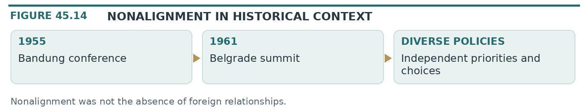

През април 1955 г. представители на двадесет и девет азиатски и африкански правителства се срещнаха в Бандунг (Индонезия). Мнозина наскоро са се появили от колониалното управление. Тяхната загриженост включваше политическа независимост, икономическо развитие, расова дискриминация и мирно съвместно съществуване. Събранието беше важен предвестник на Движението без граници, чиято първа среща на върха се проведе в Белград през 1961 г. \[<a href="/045-diplomacy-alliances-and-balance-of-power/sources/#source-22" class="cite">22</a>\]\[<a href="/045-diplomacy-alliances-and-balance-of-power/sources/#source-23" class="cite">23</a>\]\[<a href="/045-diplomacy-alliances-and-balance-of-power/sources/#source-42" class="cite">42</a>\]

Nonalignment не означава идентични политики или липсата на взаимоотношения с големи правомощия. Правителствата на държавите-членки се различаваха по отношение на вътрешните системи, икономическите интереси и конфликтите. Някои от тях получиха помощ от конкурентните блокове. Това, което обедини проекта, беше стремеж да се преследва външна политика без да се приема, че светът трябва да бъде организиран изключително около предпочитанията на двете суперсили от Студената война.

Бандунг променя перспективата, от която разказваме историята на двадесети век. Конвенционална карта на два конкурентни лагера може да напусне наскоро независими държави, засенчени според предполагаемата им вярност. Техните собствени документи разкриват други приоритети: суверенитет, край на империята, развитие и международно равенство. Нито разнообразието на движението, нито вътрешните му разногласия изтриват значението му. Тя илюстрира как дипломатическите институции могат също да оспорват дефиницията на самия международен ред.

<figure class="figure" id="figure-45-14">

<figcaption>Фигура 45.14. Благоприличието не е липсата на чуждестранни връзки. <a class="figure-anchor" href="#figure-45-14" aria-label="Link to this figure">#</a></figcaption>
</figure>
