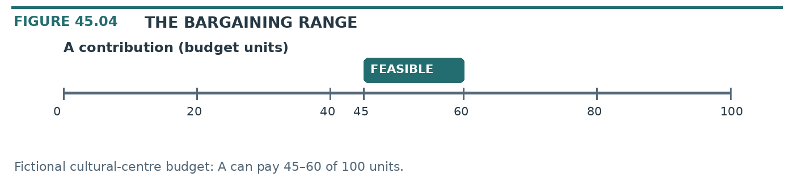

Диапазон на договаряне е набор от резултати, които всички страни предпочитат пред съответните си алтернативи. Представете си измислен културен център, който две общини искат да финансират съвместно. Град А може да допринесе най-много 60 от 100 бюджетни единици; Град Б може да допринесе най-много 55. Ако няма други ограничения, приемливият принос на А е между 45 и 60 г., защото Б трябва да може да покрие остатъка. Има диапазон, а не уникален справедлив отговор. Цифрите са измислени за преподаване; те не са модел на истински военни кризи.

Примерът показва защо споделянето на интерес не премахва несъгласието относно разпространението. И двата града предпочитат център пред нито един, но всеки би предпочел да има повече пари за други услуги. Споразумение в A=50 и B=50 е изпълнимо; така са A=58 и B=42. Нуждаем се от допълнителни принципи или история на договарянето, за да преценим кое е справедливо. Ако общите разходи се повишат до 120 и нито може да разшири бюджета си, никое разделение в рамките на първоначалните граници няма да финансира проекта.

Международните споразумения са по-сложни, защото алтернативите и предпочитанията могат да бъдат несигурни, многоизмерни и променящи се. Работата на Джеймс Fearon по войната пита защо понякога актьорите не успяват да намерят по-евтино споразумение дори когато конфликтът налага загуби. Моделът на договаряне изяснява един пъзел; това не означава, че действителните лидери притежават точни възможности или че правосъдието може да бъде сведено до полезност. \[<a href="/045-diplomacy-alliances-and-balance-of-power/sources/#source-7" class="cite">7</a>\]

<figure class="figure" id="figure-45-4">

<figcaption>Фигура 45.4. Измислен културен-центърен бюджет: А може да плати 45.60 от 100 бройки. <a class="figure-anchor" href="#figure-45-4" aria-label="Link to this figure">#</a></figcaption>
</figure>
