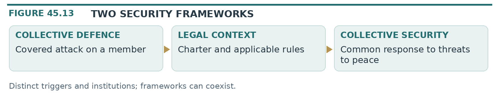

Колективната отбрана е договореност, съгласно която членовете се задължават да си помагат взаимно срещу нападение при определени условия. Колективната сигурност има за цел по-широко да организира отговор на заплахите за мира чрез обща система, която потенциално включва действия срещу член или нечлен, отговорен за агресията. Двете идеи могат да съществуват съвместно: съюзът може да разчита на правото на колективна самозащита, призната от Хартата на ООН, докато участва в по-широка рамка за колективна сигурност. \[<a href="/045-diplomacy-alliances-and-balance-of-power/sources/#source-6" class="cite">6</a>\]\[<a href="/045-diplomacy-alliances-and-balance-of-power/sources/#source-17" class="cite">17</a>\]

Разликата не е само броят на членовете. Регионалната институция може да има функции по колективна сигурност и голям съюз може да остане споразумение за защита на своите партии. Централният въпрос е какво води до действия и кой има правомощия да решава. Съгласно Хартата на ООН Съветът за сигурност носи основната отговорност за международния мир и сигурност; член 51 признава индивидуалната и колективна самозащита при спазване на нейните условия. Това са различни правни основания.

Организацията за колективна сигурност не притежава магически капацитет за изпълнение. Държавите-членки трябва да предоставят политическа подкрепа и ресурси, а решенията могат да бъдат блокирани от несъгласие. Един отбранителен съюз по същия начин зависи от надеждното сътрудничество и националното прилагане. Разликата между правно задължение и ефективни институционални действия е една от най-важните теми в тази глава.

<figure class="figure" id="figure-45-13">

<figcaption>Фигура 45.13. Различията предизвикват и институциите; рамките могат да съществуват съвместно. <a class="figure-anchor" href="#figure-45-13" aria-label="Link to this figure">#</a></figcaption>
</figure>
