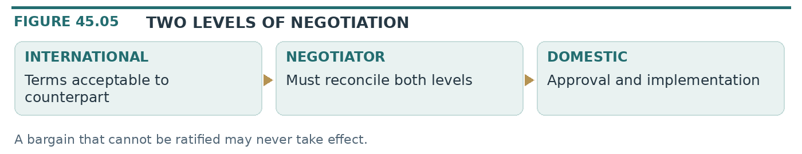

Представете си министър на търговията, преговарящ за трансгранично споразумение. На международната маса министърът трябва да намери условията приемливи за друго правителство. У дома споразумението трябва да оцелее след парламентарни дебати, правен преглед и възражения от засегнатите индустрии. Концесия, която прави чуждото правителство щастливо, може да направи ратификацията невъзможна; вътрешно популярното обещание може да бъде неприемливо в чужбина. Робърт Пътнам описва това взаимодействие чрез метафората на двустепенните игри. \[<a href="/045-diplomacy-alliances-and-balance-of-power/sources/#source-8" class="cite">8</a>\]

Домашните ограничения могат да бъдат истински или преувеличени. Лидер, който твърди, че парламентът никога няма да одобри предложение, може би точно описва законодателно мнозинство или може да използва твърдението риторично. Външният наблюдател не може да каже само от изявлението. Конституционните правила, предизборните календари, коалиционните споразумения, общественото мнение и разпределението на икономическите разходи могат да предоставят независими доказателства.

Метафората също така ни пречи да третираме страната като един човек с едно единствено желание. Министерствата, съдилищата, фирмите, синдикатите, регионалните органи и гражданите могат да имат противоречиви приоритети. В авторитарни системи обществените разногласия могат да бъдат ограничени, но елитната политика и административните ограничения не изчезват. Споразуменията, които пренебрегват националните институции, могат да изглеждат впечатляващи в момента на подписване и след това да се провалят по време на изпълнение.

<figure class="figure" id="figure-45-5">

<figcaption>Фигура 45.5. Сделката, която не може да бъде ратифицирана, може никога да не влезе в сила. <a class="figure-anchor" href="#figure-45-5" aria-label="Link to this figure">#</a></figcaption>
</figure>
