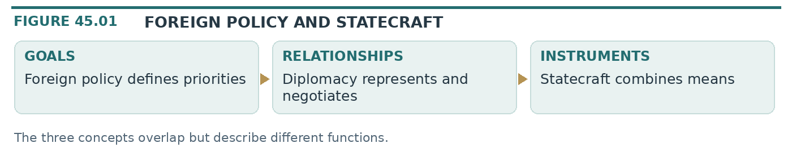

Външната политика е широкият набор от цели и избори, чрез които правителството се занимава със света извън неговата юрисдикция. Дипломацията е дейност на представяне на интереси и комуникация, преговори или управление на взаимоотношения с други международни участници. Държавната власт все още е по-широка: тя включва дипломатически, икономически, правни и други инструменти на влияние. Правителството, което решава да подобри достъпа до чужди пазари, прави външната политика; посланикът му, който обсъжда митническите правила, упражнява дипломация; комбинацията от вътрешно законодателство, търговски преговори и финансова политика е държавна власт. \[<a href="/045-diplomacy-alliances-and-balance-of-power/sources/#source-1" class="cite">1</a>\]

Не всяка дипломация се провежда от външни министри. Могат да участват ръководители на правителства, международни организации, специализирани министерства, регионални администрации и назначени пратеници. Неформалните срещи между изследователи или бивши длъжностни лица могат да подкрепят официалните процеси, без да имат правомощия да обвързват правителствата. Дипломатическата професия остава отличителна, защото упълномощени представители говорят от името на институциите, а не само за себе си. Тази власт има граници. Личната гаранция от страна на делегат не може да се равнява на правно обвързващо предприятие.

Думата дипломация понякога предполага учтивост в ежедневната реч. Международната дипломация може да бъде учтива, тъпа, потайна или принуда; нейното присъствие не ни говори много за моралния характер. Тя може да помогне за осигуряване на прекратяване на огъня или договаряне на несправедливо споразумение. Затова внимателният читател трябва да различава метод от целите, за които се използва. Политическата легитимност и международната законност са отделни въпроси от това дали усилията за договаряне са били ефективни.

<figure class="figure" id="figure-45-1">

<figcaption>Фигура 45.1. Трите понятия се припокриват, но описват различни функции. <a class="figure-anchor" href="#figure-45-1" aria-label="Link to this figure">#</a></figcaption>
</figure>
