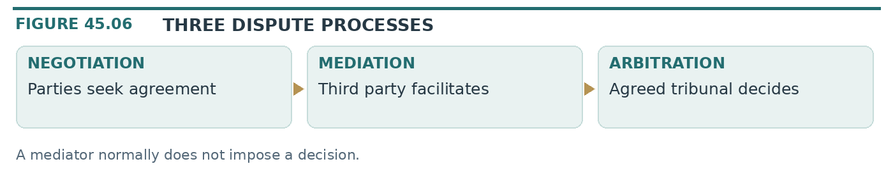

При преки преговори, партиите разговарят помежду си. Посредничеството въвежда трета страна, която да улесни комуникацията и да помогне за разглеждането на споразумение; посредникът обикновено не налага решение. Арбитражът представя спор пред договорен трибунал, чието решение може да обвързва страните съгласно приложимата рамка. Съдебното уреждане се отнася до решаването от съд с юрисдикция, например Международния съд по дела в рамките на неговата юрисдикция. Това са различни институции, не синоними за разговор. \[<a href="/045-diplomacy-alliances-and-balance-of-power/sources/#source-6" class="cite">6</a>\]\[<a href="/045-diplomacy-alliances-and-balance-of-power/sources/#source-9" class="cite">9</a>\]

Медиацията не е просто избор на уважаван неутрален човек. Ръководството на Организацията на обединените нации подчертава набор от условия, включително съгласие, включване, готовност, собственост и правни принципи. Споразумението, договорено между могъщите елити, може да спре незабавното насилие и все пак да не успее да защити групите, които липсват от масата. Безвъзмездните процедури не изискват да се третират установените факти като несигурни, нито да се третират правата на жертвата и незаконното търсене като морално еквивалентни. \[<a href="/045-diplomacy-alliances-and-balance-of-power/sources/#source-9" class="cite">9</a>\]

Един успешен процес трябва да бъде съден срещу проблема, с който се занимава. Временното споразумение за защита на хуманитарния достъп е ценно, дори ако политическите преговори останат нерешени. От друга страна, обявяването на цялостно споразумение може да означава малко, ако няма законен орган, механизъм за прилагане или участие на засегнатите общности. Дипломацията има междинни постижения и неуспехи, не само победа или поражение.

<figure class="figure" id="figure-45-6">

<figcaption>Фигура 45.6. Медиаторът обикновено не налага решение. <a class="figure-anchor" href="#figure-45-6" aria-label="Link to this figure">#</a></figcaption>
</figure>
