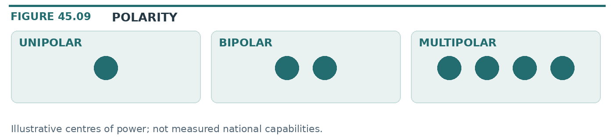

Полярността описва броя на основните центрове на властта в една система. Еднополюсността означава един преобладаващ център; биполярността описва два основни центъра; мултиполярността описва няколко. Тези категории са опростяване, а не официален правен статут. Студената война често е описана като биполярна, защото Съединените щати и Съветския съюз са основните конкурентни центрове, но Китай, неподправени държави и регионални сили все още упражнява агенцията.

Броят на полюсите зависи отчасти от това, което се измерва. Една държава може да бъде световно влиятелна във военно отношение, докато друг регион упражнява значителна икономическа или регулаторна сила. Една система може да изглежда по-концентрирана в една област от друга. Съответната единица може да бъде държава, относително сплотена група държави или институция с делегирани правомощия. Преброяването на знамена не идентифицира центровете за независимо вземане на решения.

Няма безспорен отговор, на който полярността е най-безопасна. Двама доминиращи участници могат да опростят някои отношения, като същевременно концентрират залозите на конфликта. Множество центрове могат да предоставят повече дипломатически възможности, като същевременно правят намеренията и ангажиментите по-трудни за тълкуване. Институционални правила, география, исторически оплаквания и вътрешна политика определят тези ефекти. Уверен аргумент, че определен брой полюси гарантират мир, трябва да покани същия контрол като детерминистичните твърдения в глава 43.

<figure class="figure" id="figure-45-9">

<figcaption>Фигура 45.9. Илюстративни центрове на енергия; неизмерими национални възможности. <a class="figure-anchor" href="#figure-45-9" aria-label="Link to this figure">#</a></figcaption>
</figure>
