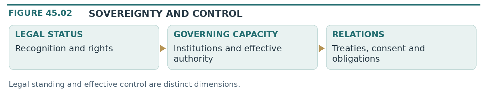

Мирът на Вестфалия през 1648 г. завършва големи конфликти в рамките на Свещената Римска империя и между европейските сили. Тя често се представя като момента, в който се роди съвременната система на суверенните държави. Историята е удобна за времевата линия на учебника, но компресира много по-дълга и неравномерна история. Империята продължава да съществува с припокриващи се органи, и европейските правомощия упражнява власт отвъд океана чрез империи, търговски дружества и колониално завоевание. Историкът Андреас Осиандер твърди, че не приема селищата като проста основа на съвременния суверенитет. \[<a href="/045-diplomacy-alliances-and-balance-of-power/sources/#source-5" class="cite">5</a>\]

Суверенността засяга властта на една политическа общност да се управлява сама и нейното положение спрямо другите. Полезно е да се разграничи правния статут от ефективния контрол. Призната държава може да се бори да управлява части от територията си; дадена организация може да контролира територия без широко разпространено признаване като държава. Международното признаване, членството в организации и дипломатически отношения са свързани, но не са идентични. Държавата може да спре признаването или дипломатическите отношения по правни или политически причини.

Международната система понякога се нарича анархична, защото й липсва едно правителство с всеобщ авторитет над държавите. Това не означава, че няма правила. Договорите, обичайното право, институциите, икономическите отношения и репутацията ограничават поведението. Липсата на централен суверен обяснява някои проблеми с правоприлагането; той не разрешава агресия или оправдава нарушения на международното право. \[<a href="/045-diplomacy-alliances-and-balance-of-power/sources/#source-6" class="cite">6</a>\]

<figure class="figure" id="figure-45-2">

<figcaption>Фигура 45.2. Правният статут и ефективният контрол са различни измерения. <a class="figure-anchor" href="#figure-45-2" aria-label="Link to this figure">#</a></figcaption>
</figure>
