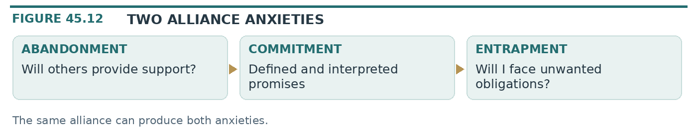

Глен Снайдер идентифицира напрежението в съюзите. Един член може да се страхува от изоставяне, което означава, че партньорът може да не осигури очаквана подкрепа, когато има значение. Тя също може да се страхува от капан, което означава, че може да бъде приведен в конфронтация, която иначе ще избегне. Устойчивостта, която намалява едното безпокойство, може да увеличи другото, ако партньорите вярват, че ще получат безусловна подкрепа. \[<a href="/045-diplomacy-alliances-and-balance-of-power/sources/#source-16" class="cite">16</a>\]

Да разгледаме една измислена асоциация на три крайбрежни града, които се съгласяват да предоставят спешна помощ. Градът се страхува, че партньорите му няма да помогнат при наводнение. Нейните партньори се притесняват, че от тях ще се очаква да финансират проекти извън споразумението. Ясни определения на отговорностите, редовен преглед и процедури за легитимно вземане на решения могат да намалят объркването, но членовете все още могат да не са съгласни с извънредни ситуации. Аналогията илюстрира конкурентни очаквания, а не модел на реални въоръжени ангажименти.

Алиансите управляват дилемата чрез политически и институционални практики, а не чрез един перфектен договор. Текстът на Договора, консултациите, националните процедури за вземане на решения и историята на сътрудничеството са от значение. Анализаторът трябва да различава страховете от резултатите. Доказателствата, че едно правителство изразява загриженост относно изоставянето, не доказват, че изоставянето би се случило. Доказателствата за спор между съюзниците не показват, че цялата им връзка се е сринала.

<figure class="figure" id="figure-45-12">

<figcaption>Фигура 45.12. Един и същ съюз може да създаде и двете тревоги. <a class="figure-anchor" href="#figure-45-12" aria-label="Link to this figure">#</a></figcaption>
</figure>
