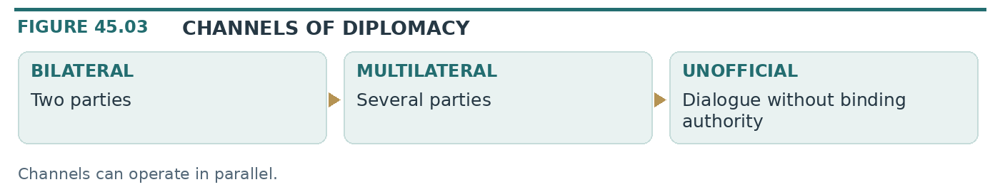

Двустранна дипломация се случва между две партии; многостранната дипломация обединява няколко. Срещата между двама външни министри е двустранна, дори и да се състои на голяма конференция. Преговорите в Организацията на обединените нации са многостранни, но делегатите все още провеждат двустранни консултации по границите. Разграничаването има значение, защото двустранното споразумение може да бъде по-лесно пригодено, докато многостранната договореност може да се справи с проблеми, които нито едно правителство не може да реши самостоятелно.

Публичната дипломация комуникира по-скоро с чужди общественици, отколкото само с длъжностни лица. Културните обмени, стипендиите и публичните обяснения на политиката могат да формират доверие. Те също могат да бъдат възприемани като пропаганда. Твърдение за културно приятелство не е доказателство, че публиката наистина намира посланието за убедително. Дипломатиката Track II, провеждана от неофициални участници, може да изследва идеи, които упълномощените длъжностни лица все още не могат да одобрят; тя не трябва да се бърка с официално споразумение.

Обратните контакти могат да позволят на правителствата да изследват компромиси без незабавна публичност, докато официалните преговори създават записи и подкрепят отчетността. Секретността може да бъде полезна за откровено обсъждане, но също така може да прикрие изключения и ангажименти от хора, които имат право на контрол. Въпросът не е дали тайната винаги е добра или лоша; това е институционалната цел, която тя служи, кой я е разрешил и дали произтичащите от нея задължения могат да бъдат изпълнени законно.

<figure class="figure" id="figure-45-3">

<figcaption>Фигура 45.3. Каналите могат да работят паралелно. <a class="figure-anchor" href="#figure-45-3" aria-label="Link to this figure">#</a></figcaption>
</figure>
