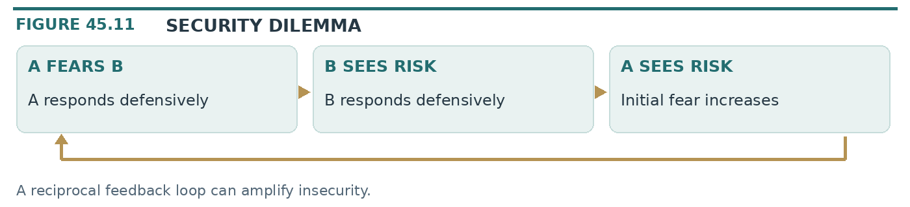

Правителството се страхува от съседа си и увеличава капацитета си за отбрана. Съседът вижда повишена способност, но не може да бъде сигурен за бъдещи намерения. Той реагира, като разширява собствения си капацитет. Първото правителство тълкува това като потвърждение на първоначалния му страх. И двамата могат да се почувстват по - малко сигурни, въпреки че вярват, че действията им са защитни. Изследванията на Робърт Джервис показват условия, при които такава реципрочна несигурност става повече или по-малко тежка. \[<a href="/045-diplomacy-alliances-and-balance-of-power/sources/#source-15" class="cite">15</a>\]

Този механизъм е обратна връзка, свързваща системите на глава 7 с геополитиката. Интензитетът му зависи от информацията, историческия опит, характера на способностите и как може да се наблюдава надеждно задържане. Дипломатическите отношения, които изясняват намеренията, могат да намалят известна несигурност, но никое комюнике не може да докаже намеренията на всяко бъдещо правителство. Съществуващото недоверие може да доведе дори до наистина помирителни действия, които да бъдат тълкувани подозрително.

Не всяко съперничество е дилема за сигурност. Някои участници търсят териториално разширяване или господство; някои спорове отразяват истински несъответствия, а не недоразумение. Наричането на агресията взаимна спирала без разглеждане на доказателства може да замъгли отговорността. Аналитичната задача е да се разграничат отбранителни мотиви, агресивни цели, възприятие и поведение, като се помни, че мотивите не премахват правните задължения. Теорията, описваща как расте несигурността, не е твърдение, че всички страни носят еднаква вина.

<figure class="figure" id="figure-45-11">

<figcaption>Фигура 45.11. Взаимната обратна връзка може да усили несигурността. <a class="figure-anchor" href="#figure-45-11" aria-label="Link to this figure">#</a></figcaption>
</figure>
